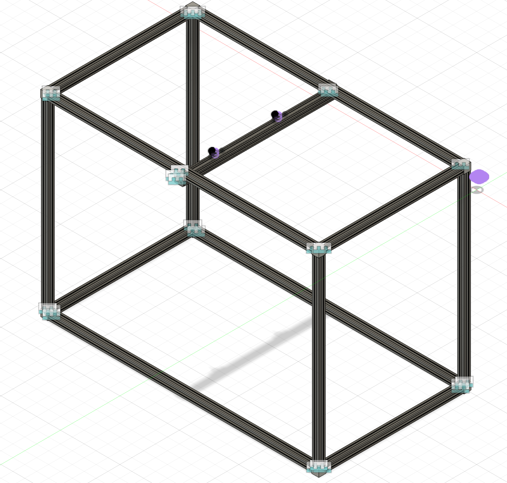
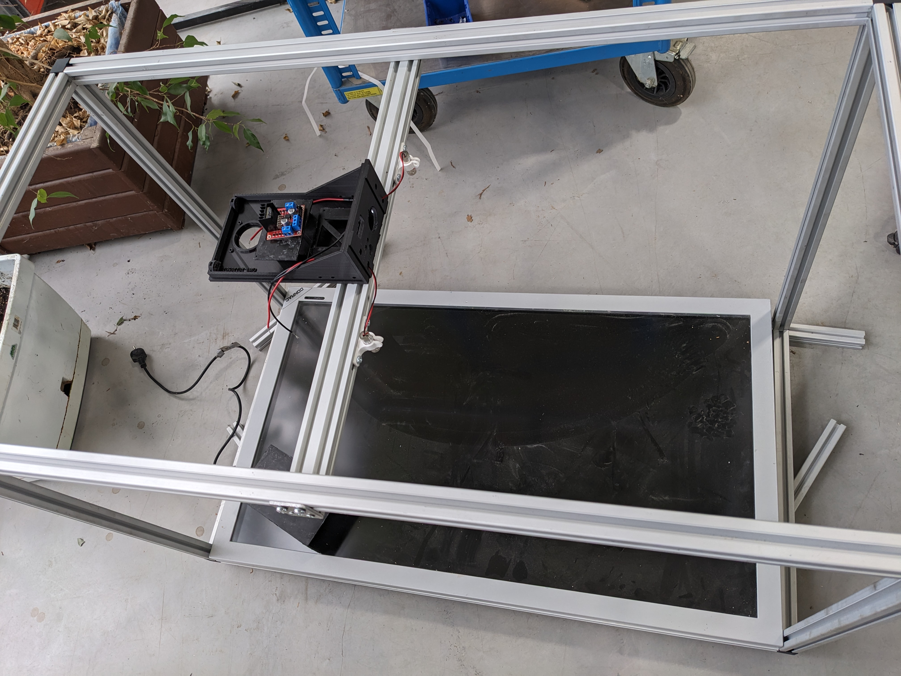
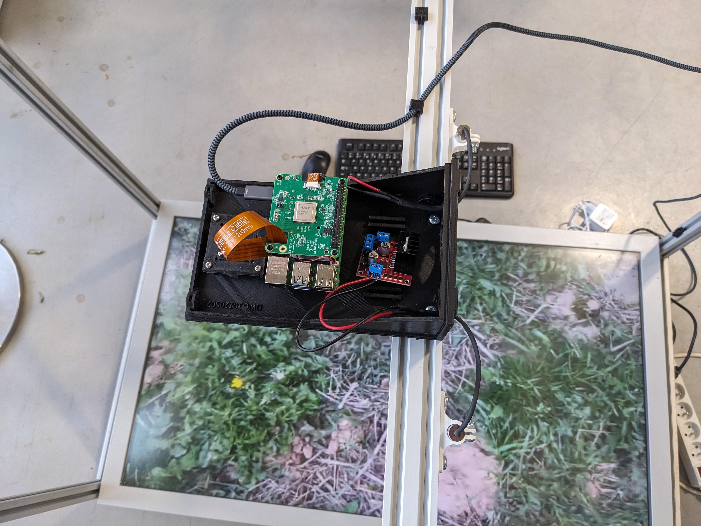
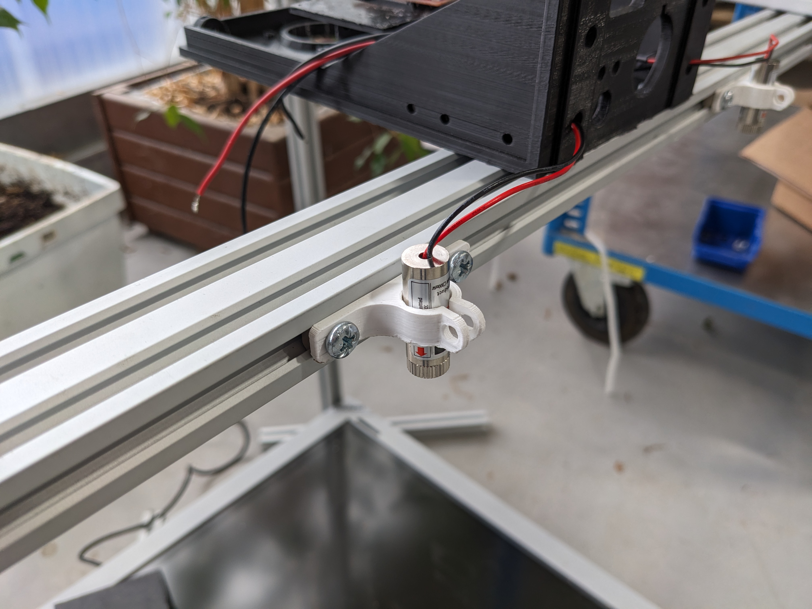
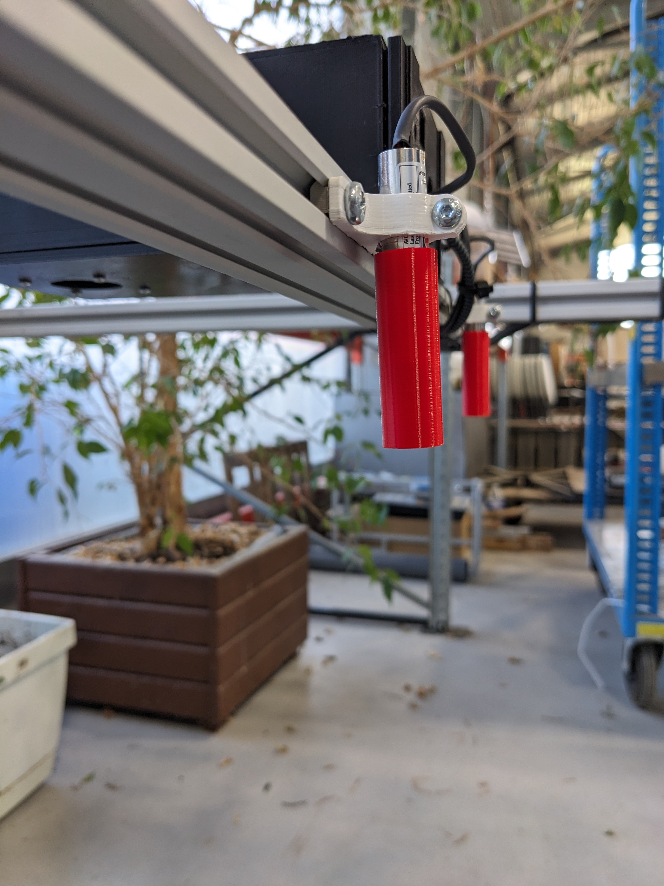
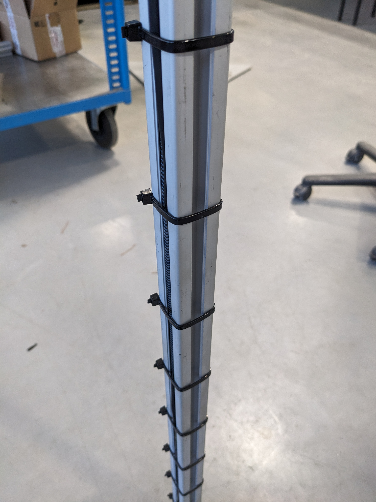
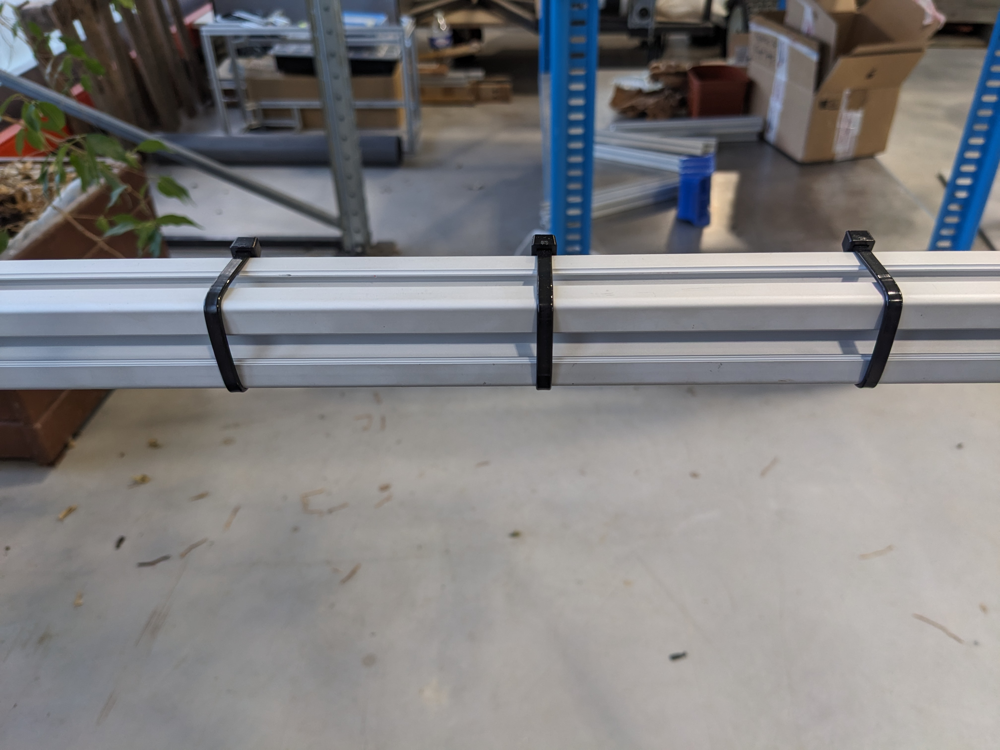

# Conception banc de démonstration

Dans le cadre de la conception du banc de démonstration, nous avons retenu l'utilisation de profilés en aluminium extrudé de section carrée, dotés de quatre rainures latérales. Ce choix structurel présente plusieurs avantages, notamment une modularité accrue, une facilité d’assemblage, ainsi qu'une meilleure ergonomie pour le transport et l’intégration des composants.

Par la suite, nous avons réalisé une conception 3D pour connaître le nombre de profilés et la dimension exacte qu'il nous fallait.

Concernant la simulation du défilement des adventices, nous avons opté pour un écran de télévision en lieu et place d’un convoyeur mécanique. Cette décision repose sur des considérations pratiques et techniques : l’utilisation d’un convoyeur impliquerait le développement d’un système d'entraînement motorisé, ainsi qu’un dispositif de fixation des adventices pour assurer leur stabilité lors du déplacement. À l’inverse, la solution vidéo permet de reproduire fidèlement le mouvement des adventices via une simple lecture en boucle, tout en réduisant la complexité mécanique du dispositif.

Deux modules laser ont été installés afin de simuler les jets émis par les buses d’un pulvérisateur. L’écartement entre les deux lasers est de 25 cm, correspondant à l’espacement standard entre buses sur une rampe de pulvérisation. Les lasers sont montés sur des supports dédiés assurant leur stabilité et leur alignement, comme illustré sur la photo ci-dessous.

La caméra a été positionnée à une hauteur de 72,5 cm par rapport à l’écran, de manière à couvrir l’intégralité de la surface visible grâce à son angle de vue de 76°. Afin d’ajuster le faisceau des lasers, dont la projection excédait initialement les dimensions de l’écran, nous avons conçu des cylindres optiques permettant de concentrer et rediriger le faisceau lumineux. Chaque laser est ainsi calibré pour couvrir précisément la moitié de l’écran, soit une surface de 30 cm.

Dans un souci d’intégration soignée et fonctionnelle, des colliers de serrage ont été mis, assurant un montage propre et sécurisé.

---

[← Retour au sommaire](../README.md)
