# Création d'un dataset via Roboflow

La formule gratuite du site (sans abonnement) permet uniquement de créer des datasets publics !!!

Pour utiliser Roboflow, il faut tout d'abord créer un compte via l'onglet sign in du site internet.

Ensuite, il faut se rendre sur son espace de travail nommé "Workspace".

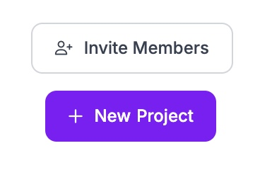

il faut ensuite cliquer sur "New project" en haut à droite de l'écran.

Le site va ensuite afficher la fenêtre de création de la page de projet.

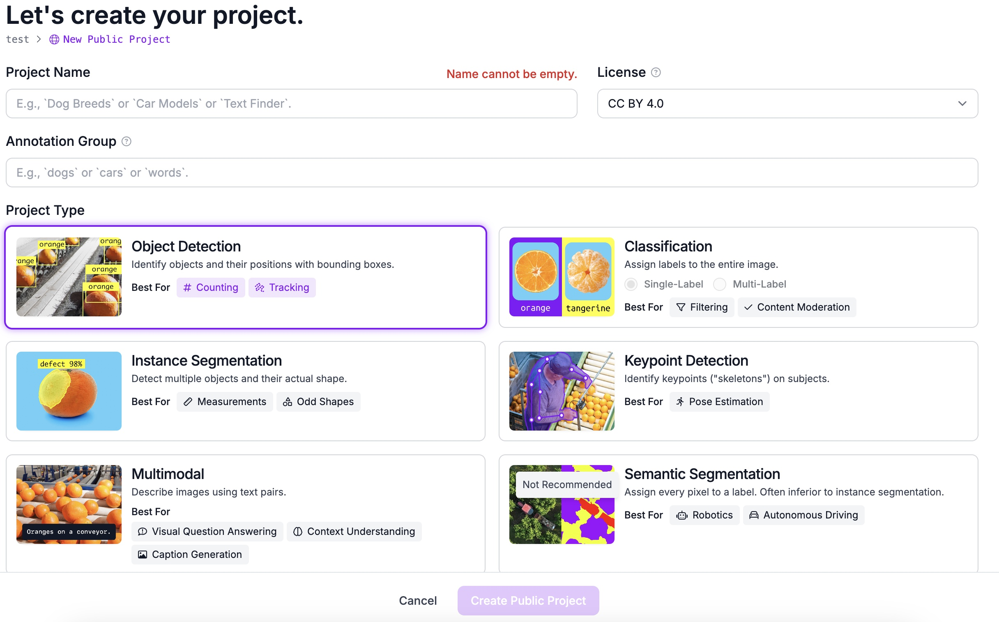

Celle-ci demande de donner un nom au dataset, de lui donner une référence pour une recherche si l'on a créé plusieurs datasets. il demande aussi le type d'ia que l'on veut entraîner (détection d'objets, segmentation,...)

Après cela, il faut donc ajouter des images au dataset. La page d'import des images est la première qui apparaît après la création du projet.

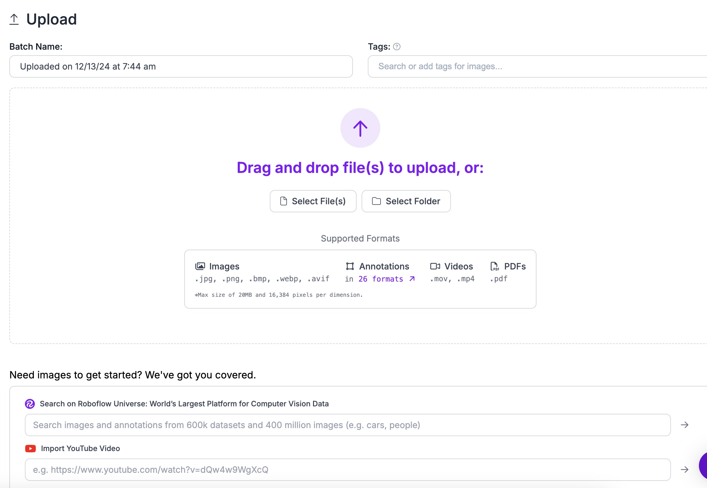

Après l'import, plusieurs options sont proposées. On peut continuer d'importer d'autres images, prendre des images ressemblantes à celles déjà importées, chercher un autre dataset à ajouter directement dans celui que l'on créé. Soit sauvegarder et continuer ("Save and Continue").

Sur l'exemple ci-dessous, j'ai ajouté une photo de pièce de monnaie, le site me propose d'ajouter des images de pièces.

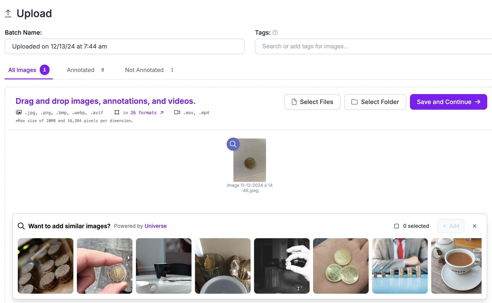

Après avoir sauvegardé, le site propose automatiquement de faire la sélection des zones des images qu'il faut reconnaitre.

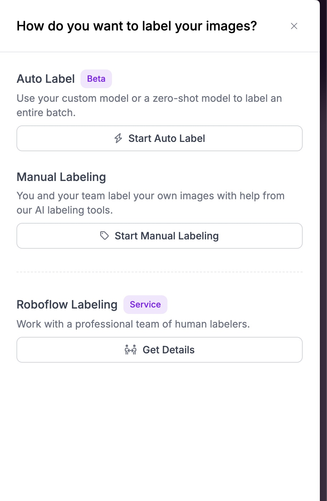

Pour la sélection manuelle, il cliquer sur "Start Manual Labeling".

La fenêtre ci-dessous va s'afficher :

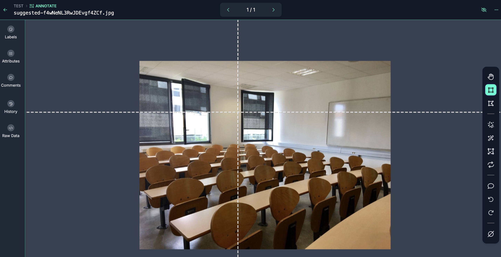

Il faut ensuite sélectionner la zone de l'objet en question.

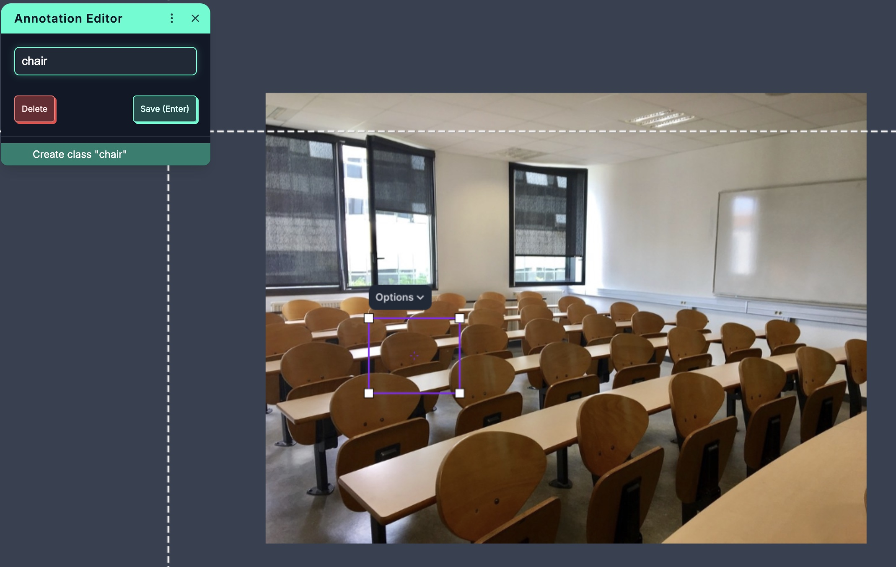

Une fenêtre va s'ouvrit pour faire le choix de la catégorie de l'objet.

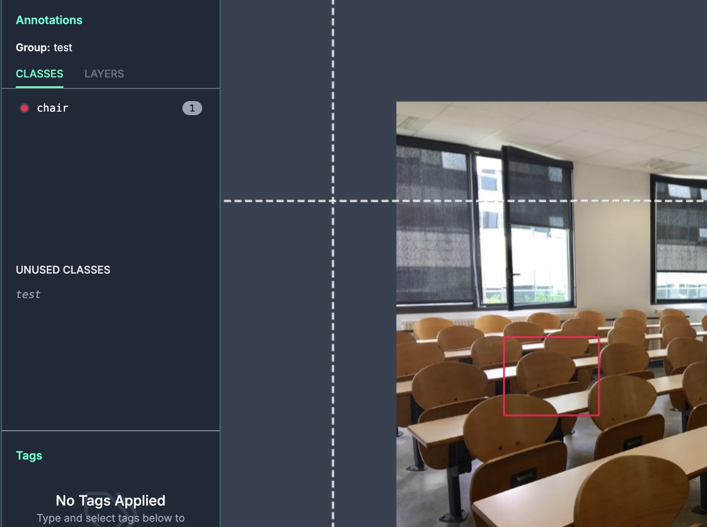

Une fois l'annotation faite, sera affiché les différentes classes d'objets, ainsi que les couches créées pour détecter l'objet.

On peut maintenant ajouter l'image au dataset avec le bouton "Add __ Image to Dataset" :

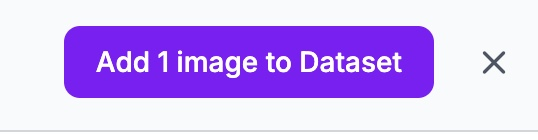

Roboflow va proposer de modifier le découpage de l'image pour les différentes phases d'entrainement de l'ia (train pour la phase d'enseignement de l'ia, faire le lien entre les données et ajuster ses paramètres, validation pour l'évaluation des performances du modèle pour réajuster des paramètres, test pour l'évaluation du modèle face à des données inconnues pour le modèle).

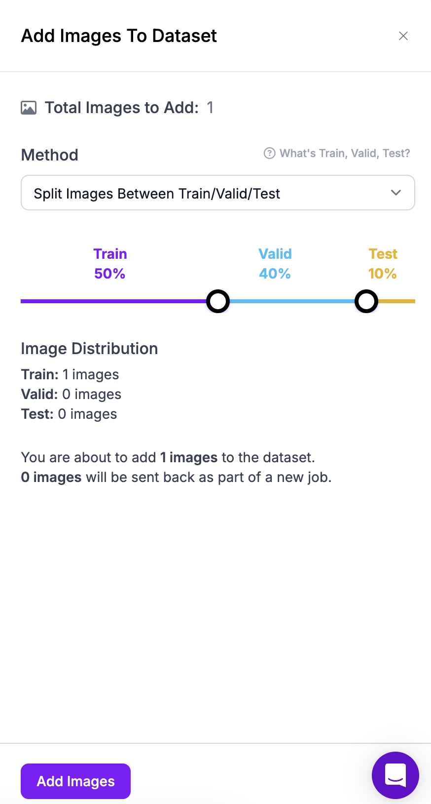

Une fois les images ajoutées, nous pouvons créer une nouvelle version du dataset :

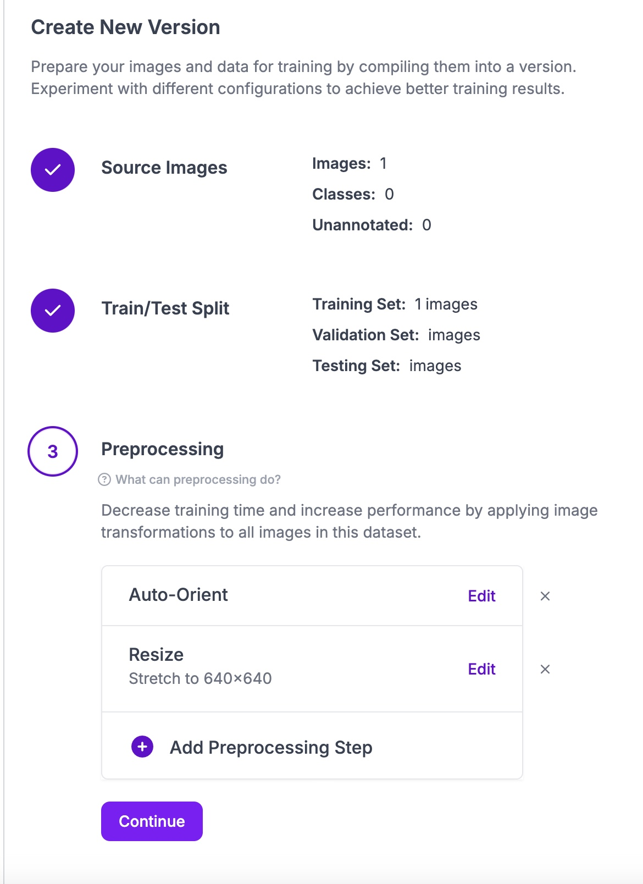

Pour valider, il faut cliquer sur "continue" jusqu'à ce que tous les étapes soient effectuées.

Le dataset ainsi créé apparaitra de la façon suivante :

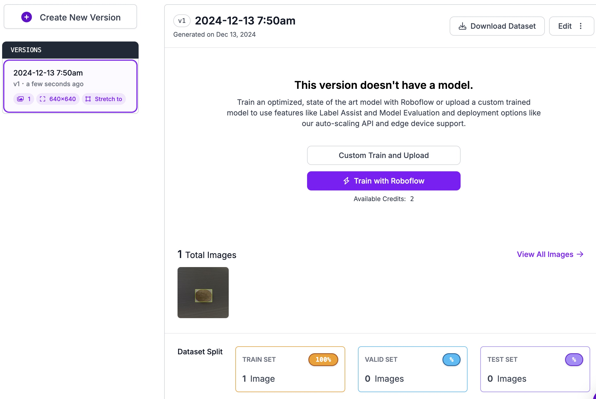

Il est maintenant disponible au téléchargement par tous.

Pour le télécharger, il faut utiliser le petit onglet nommé "Download Dataset" en haut à droite de l'écran.

la page de téléchargement s'affichera et permet de récupérer le dataset pour différentes versions de YOLO, ainsi que d'autres modèles, il peut aussi être exporté en fichier .zip pour un entrainement en local sur un ordinateur personnel.

Pour le projet, YOLOv11 a été selectionné et génère du code python pour l'installer dans le bureau virtuel présenté sur la page "Entrainement d'une intelligence artificielle" de la page du projet.

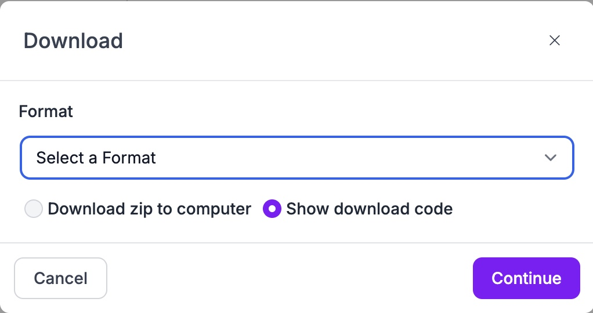

---

[← Retour au sommaire](../README.md)
