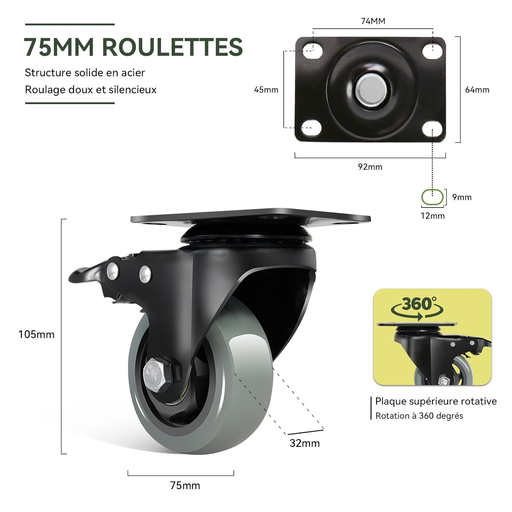
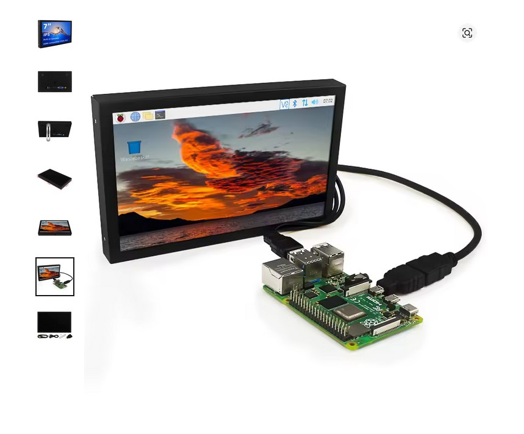

# Modification pour Salon et expo

## Ajout de roulette sous le cadre

L'ajout de roulette permet de faciliter les déplacements du banc d'essai sans avoir recours à un transpalette.

Référence des roulettes : "Lien":https://www.amazon.fr/BAOLIHUI-Roulettes-Pivotantes-Chariots-Rotation/dp/B0C1SF2NZ9/ref=sr_1_2_sspa?__mk_fr_FR=%C3%85M%C3%85%C5%BD%C3%95%C3%91&crid=1IFGXEF175FG1&dib=eyJ2IjoiMSJ9.YQvPh8D-72CkbMwysuH_zTssXPdOcup51OOBz7HiPA6oSZH-B84Xc_f9L5l_KUnTV0xV7yjkLnaOIlWwXgavWwsOv1dFaspU-jQ72gs7LspBdofTVw2QOENAPLJHOY9cuuc0LrSrdaJbOoLKd4Ouv6e0vvAuRRmIJCSU8J83pavRnqjaLcmecize5bBDpARakK9BAPdLUQ0z7xpvaSCrcWA-hhhebAcWJA70oKdJR8v6f-m7LWHFARj_ACup4mVdezY01wV2ZmMAc_hW8nSkN2jD92WI2U4pnlwZWq6VTCo.1dxp2m-NKm1yIHvqPegU7-1iMxsS6I4ioQISMFnouAs&dib_tag=se&keywords=roulette%2B75%2B45&qid=1759137455&sprefix=roulette%2B75%2B45%2Caps%2C68&sr=8-2-spons&sp_csd=d2lkZ2V0TmFtZT1zcF9hdGY&th=1

Platine avec perçage 74x45mm entre les axes.
Diamètre de roue 75mm.



## Ajout d'un écran 7"

L'ajout d'un écran permet de visualiser la vue de la caméra et de mieux se rendre des calculs en temps réel du Raspberry Pi

Référence de l'écran : "Lien":https://fr.aliexpress.com/item/1005008558996530.html
1024x600x avec haut parleur intégré.
Peut être alimenté en 5v avec un USB type C ou en 12v (min 1A) avec un connecteur barrel jack.
Il est connecté au Raspberry Pi avec un câble HDMI vers micro HDMI.
L'orientation de l'écran peut être changé via l'interface de celui et/ou via les paramètres du Raspbian OS installé sur le Raspberry Pi

L'écran est fixé au châssis grâce à une tôle d'acier de 3mm d'épaisseur sur laquelle des trous sont percés. 4 en M4 pour le système Vesa de l'écran (65x54mm entre les axes) et 2 pour les vis de fixation M6. Nous avons utilisé des écrou frein pour fixer la plaque au rail aluminium.



## Création d'un service pour exécuter le script python au démarrage

"Script", ici, est une variable qui dépend du nom de votre fichier. Le chemin dépend de l'endroit ou se trouve votre fichier sur votre stockage mémoire.

1. Crée un fichier de service :
```text
sudo nano /etc/systemd/system/Script.service
```

2. Contenu à copier dans le service :

```text
[Unit]
Description=Lancement du script Python Yolo V8
After=network.target

[Service]
ExecStart=/usr/bin/python3 /chemin/vers/Script.py
Restart=always
User=pi

[Install]
WantedBy=multi-user.target
```

3. Pour recharger systemd et active le service :

```text
sudo systemctl daemon-reload
sudo systemctl enable script.service
sudo systemctl start script.service
```

6. Pour vérifier son état :
```text
Systemctl status script.service
```

## Création d'un service pour lire la piste audio au démarrage

"music", ici, est une variable qui dépend du nom de votre fichier. Le chemin dépend de l'endroit ou se trouve votre fichier sur votre stockage mémoire.

1. Pour installer VLC (sur Raspbian OS)
```text
sudo apt update
sudo apt install vlc
```

2. Tester la commande dans le terminal :

Pour lire un fichier WAV en boucle :

```text
cvlc --loop /chemin/vers/tonfichier.wav
```

*cvlc* est la version sans interface graphique, idéale pour un Raspberry Pi en mode headless.
L’option *--loop* relance automatiquement le fichier à la fin.

3. Crée un fichier de service :
```text
sudo nano /etc/systemd/system/music.service
```

4. Contenu à copier dans le service :

```text
[Unit]
Description=Lecture WAV au démarrage avec VLC
After=network.target sound.target

[Service]
ExecStart=/usr/bin/cvlc --loop /chemin/vers/tonfichier.wav
Restart=always
User=pi

[Install]
WantedBy=multi-user.target
```

5. Pour recharger systemd et active le service :

```text
sudo systemctl daemon-reload
sudo systemctl enable music.service
sudo systemctl start music.service
```

6. Pour vérifier son état :
```text
Systemctl status music.service
```

## Ajout d'un casque pour lire l'audio

Afin d'améliorer les condition d'écoute des explications audio de Robin Trournemolle en condition de salon, un casque Usb a été ajouté au système. Ce casque est branché à l'aide d'une rallonge au Raspberry Pi afin de pouvoir en changer si besoins.

## Re-conception de la boite

La boite contenant l’électronique a été modifié afin de rendre les composants visible, assurer une meilleurs protections de ceux ci et des câblages. Il s'agit d'un modèle du fabricant Fibox.

---

[← Retour au sommaire](../README.md)
