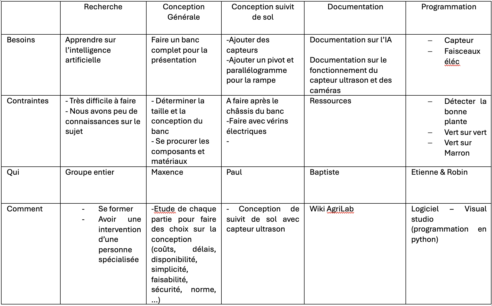
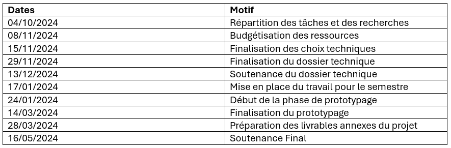
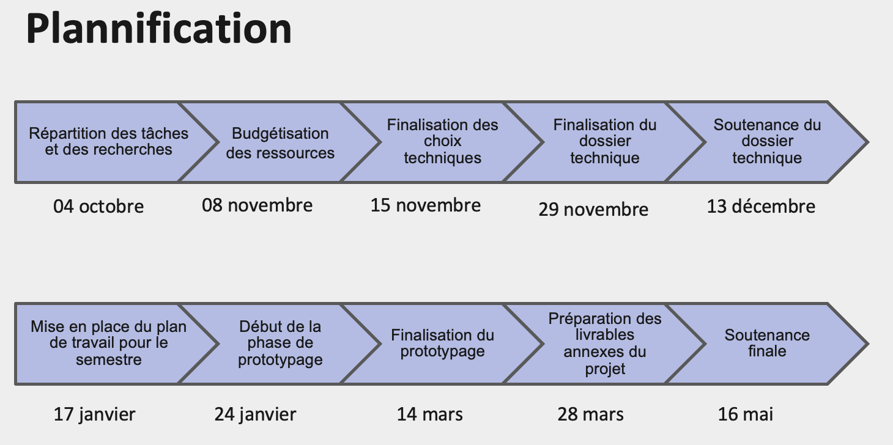

# Planification

## Répartition des tâches

* Chargé de la partie mécanique et assemblage : Maxence et Etienne
* Chargé de la documentation du projet : Baptiste
* Chargés de la programmation : Robin
* Chargé de la conception 3D : Paul

---

[← Retour au sommaire](../README.md)
