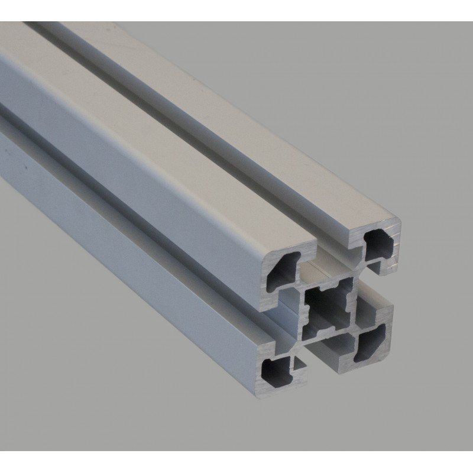
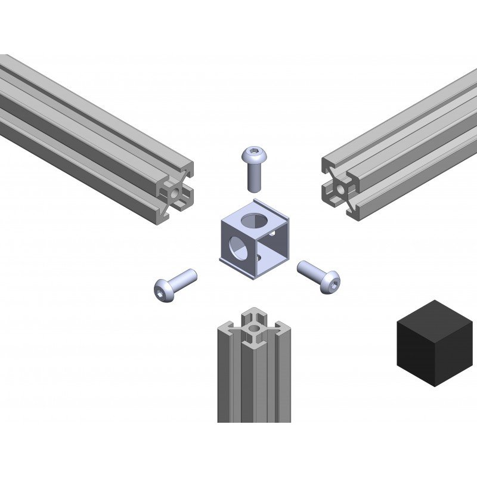
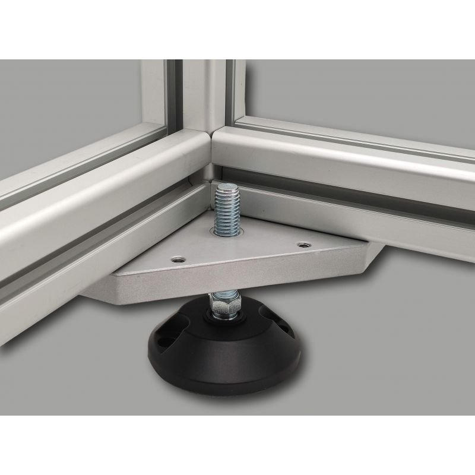

# Solutions Techniques

Pour la réalisation du châssis, nous avons choisi une armature en profilé aluminium de série 50.
Cela permet de transporter facilement le démonstrateur, car il sera léger et facilement démontable.

Pour ces profilés, nous avons choisi le fournisseur SystéAl, car ils vendent ces profilés découpés à la taille souhaités. Ils vendent aussi les accessoires pour ces profilés. Notamment les connecteurs entre profilés et des embouts.

  

Pour le choix du système informatique et la base du projet, nous avons choisi le projet Open Weed Locator ("Lien de la page GitHub du projet Open Weed Locator":https://github.com/geezacoleman/OpenWeedLocator).

Ce projet présent sur GitHub nous parut intéressant à prendre comme base, car il dispose d'une documentation très complète avec une liste de composants et un logiciel pré configuré.

Il nous a servis pour avoir une liste de composants informatiques à commander et utiliser ainsi que le boîtier imprimé en 3D. Le tout reste modulaire et modifiable afin de trouver la solution de détection la plus efficace.

---

[← Retour au sommaire](../README.md)
