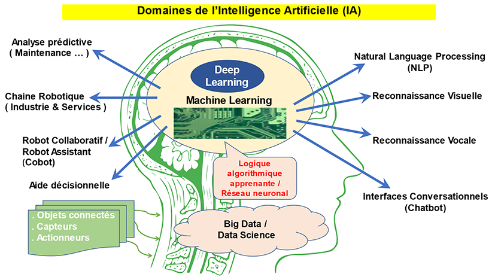
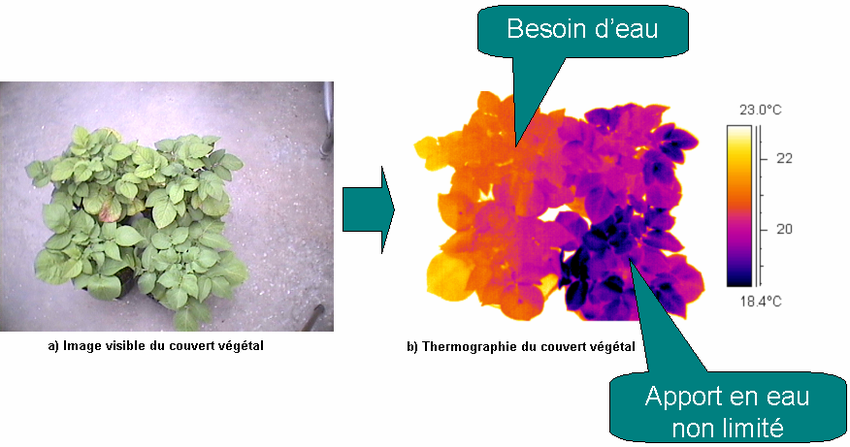
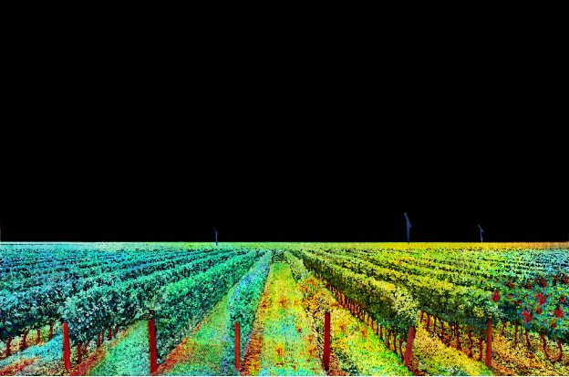
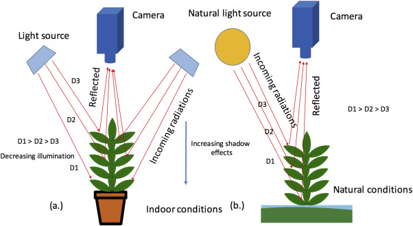
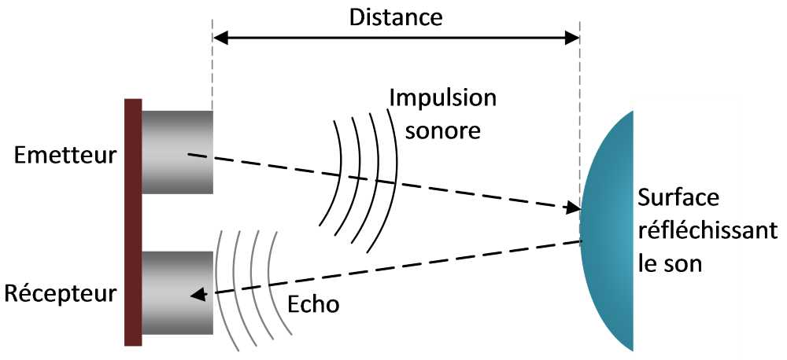

# Veille technologique

Le Target spray travaille sur une variété de technologies, spécialisé dans la détection, la pulvérisation et en automatisation.
Voici quelques solutions technologiques disponible dans le Target spray :

* Caméra RGB et multispectrales : Ce sont des caméras qui détectent les différences de couleur et de réflectance entre les cultures et les mauvaises herbes, même dans les conditions de faible luminosité ( Nuit ).
Lien internet : https://fr.wikipedia.org/wiki/Cam%C3%A9ra_multispectrale

Fonctionnement :
      Plante vers ==>

    Caméra RGB
  Capteur rouge
  Capteur vert
  Capteur bleu

        +

  Traitement d'image
 - Analyse spectrale
 - Détection de couleurs
 - Mesures biométriques

       =

  Interprétation
 - État de santé
 - Stade de croissance
 - Besoins nutritifs
Source : Perplexity

*  Vision artificielle et intelligence artificielle : Ce sont des modèles de deep learning comme YOLOv5, permettant une identification rapide et précise des mauvaises herbes ou des cibles spécifique en temps réel.
Lien internet : https://fr.wikipedia.org/wiki/Intelligence_artificielle

Source : https://www.officiel-prevention.com/dossier/protections-collectives-organisation-ergonomie/logiciels-applications-de-securite/la-prevention-des-risques-professionnels-de-lintelligence-artificielle

Deep learning : C'est une option de l'intelligence artificielle qui utilise des réseaux neuronaux artificiels complexes pour traiter et analyser des données. Il s'agit d'une évolution des méthodes d'apprentissage machine traditionnelles, avec des capacités accrues pour gérer des volumes massifs de données et des structures complexes.
Lien internet : https://theconversation.com/deep-learning-des-reseaux-de-neurones-pour-traiter-linformation-76055?gad_source=1&gclid=Cj0KCQiA3sq6BhD2ARIsAJ8MRwVwfhPaq0PdrnI9p2vlhBfnchrjzziUTtmGV_YGt2B7P5x8KM_BT3gaAgJxEALw_wcB

 Acquisition                Traitement                Analyse et
  d'image        -->      par deep learning|   -->    décision

 - Caméras haute        - Réseaux de             - Détection de
   résolution            neurones                maladies
 - Positionnement       - Segmentation           - Identification
  stratégique          - Classification          d'adventices
- Capture              - Reconnaissance        - Évaluation de
   continue               de formes               croissance
Source : Perplexity

YOLO : (You Only Look Once ) est une version d’un modèle de vision par ordinateur utilisé pour la détection d'objets. Il appartient à la famille des modèles YOLO, réputés pour leur vitesse et leur précision dans l'identification et la localisation d'objets dans des images ou des vidéos en temps réel.
Lien internet : https://docs.ultralytics.com/fr/yolov5/tutorials/architecture_description/

Type de capteur :

* Détection infrarouge : Ils est utilisé pour les pulvérisateurs automatiques dans les vergers, cette technologie aide à identifier les plantes grâce à leur signature thermique.
Lien internet : https://fr.wikipedia.org/wiki/D%C3%A9tecteur_infrarouge

Source : https://www.researchgate.net/figure/Detection-precoce-de-plants-en-stress-hydrique-par-thermographie-infrarouge_fig26_304347274
Le capteur à détection infrarouge analyse les besoins de la plante selon une certaines couleur de thermographie qui permet de connaitre ces besoins.

* LIDAR : (Light détection and Ranging ) Ils analysent en 3D les contours des cibles, souvent utilisé dans les vergers pour pulvériser sur des arbres.
Lien internet : https://fr.wikipedia.org/wiki/D%C3%A9tecteur_infrarouge

Source : https://www.usinenouvelle.com/editorial/ce-lidar-analyse-a-distance-la-sante-des-vegetaux-pour-augmenter-les-rendements-agricoles.N2205853
Grâce au capteur Lidar on peut observer la santé des vignes, à gauche en bonne santé et à droite en mauvaise santé.

* Pulvérisateurs intelligents pour les vergers :  Ce sont des systèmes qui intègrent des capteurs infrarouges et des algorithmes de profilage pour s'adapter à la forme et à la taille des arbres.

* Détection spectrale hyperspectral : Ils fournit des informations détaillées sur la santé des plantes et permet de cibler avec précision les zones infectées.
Lien internet : http://www.sfpt.fr/hyperspectral/?page_id=168#:~:text=L'imagerie%20hyperspectrale%20permet%20de,d%C3%A9pend%20de%20leur%20composition%20chimique.

Source : https://www.sciencedirect.com/science/article/pii/S1537511017302635
Grâce à la détection spectrale hyperspectral, la caméra et la lumières naturelle analyse la plante et les feuilles afin de connaitre précisément l'état de santé de la plante.

* Capteurs ultrasonique : Émettent des ondes sonores pour mesurer les distances et identifier des obstacles ou des plantes. Souvent utilisés pour des applications à faible coût ou dans des environnements où la vision peut être obstruée.
Lien internet : https://www.microsonic.de/fr/support/capteurs-%C3%A0-ultrasons/principe.htm

Source : https://arduino.blaisepascal.fr/capteur-de-distance-a-ultrasons/
En émettant une onde sonore, la caméra recoit à nouveau l'onde sonore, cela lui permet de connaitre la distance entre la rampe et les plantes.

* Capteurs de spectroscopie : Spectromètres proches infrarouges (NIR) : Analyse les plantes pour identifier les espèces et leur état de santé.
Capteurs de fluorescence : Détectent la fluorescence chlorophyllienne pour évaluer la santé des plantes et identifier les zones stressées.
Lien internet : https://bionef.fr/produit/le-monitoring-pam/

Capteur pour réaliser la pulvérisation :

* Capteurs chimiques et environnementaux : Capteurs d’humidité : Mesurent l’humidité ambiante pour ajuster la pulvérisation afin d’éviter les pertes dues à l’évaporation.
Capteurs de vent : Évaluent la direction et la vitesse du vent pour éviter la dérive des produits chimiques.

Ces capteurs sont souvent combinés dans des systèmes hybrides pour améliorer la précision et la fiabilité de la pulvérisation ciblée, même dans des environnements agricoles complexes.

* Carbon Bee : SmartstrikerX, est composé d'un capteur x, d'un contrôleur x, et d'un isobus VT.
Elle a différent mode de détection :
*  Vert sur marron
* Vert sur vert

Et elle a différent mode de pulvérisation :
*  Pulvérisation localisée
* Pulvérisation à double débit
* Pulvérisation modulante

Les capteurs SmartstrikerX, détecte les mauvaises herbes, cultures ou maladies à 3 mètres devant la rampe. elle génère une carte en temps réel des mauvaises herbes et des cultures avec détection, pulvérisation, dose appliquée et sauvegarde des produits chimiques. On peut donc grâce à la carte faire de la pulvérisation par pulvérisation localisée, bi dose ou modulation du débit.

Lien internet :

https://carbonbee.fr/
https://docs.ultralytics.com/models/yolo11/
https://github.com/ultralytics/ultralytics
https://universe.roboflow.com/
https://www.youtube.com/watch?v=SILmGmR6S_8
https://colab.research.google.com/
materiel : Raspberry Pi 5 (Raspbian 64bit Bookworm), Camera V3

Bibliographie :

https://www.researchgate.net/journal/Frontiers-in-Plant-Science-1664-462X/publication/366400762_Design_of_field_real-time_target_spraying_system_based_on_improved_YOLOv5/links/667c00b48408575b838afcd1/Design-of-field-real-time-target-spraying-system-based-on-improved-YOLOv5.pdf?_tp=eyJjb250ZXh0Ijp7ImZpcnN0UGFnZSI6InB1YmxpY2F0aW9uIiwicGFnZSI6InB1YmxpY2F0aW9uRG93bmxvYWQiLCJwcmV2aW91c1BhZ2UiOiJwdWJsaWNhdGlvbiJ9fQ

https://www.frontiersin.org/journals/plant-science/articles/10.3389/fpls.2021.753603/pdf?isPublishedV2=false

---

[← Retour au sommaire](../README.md)
