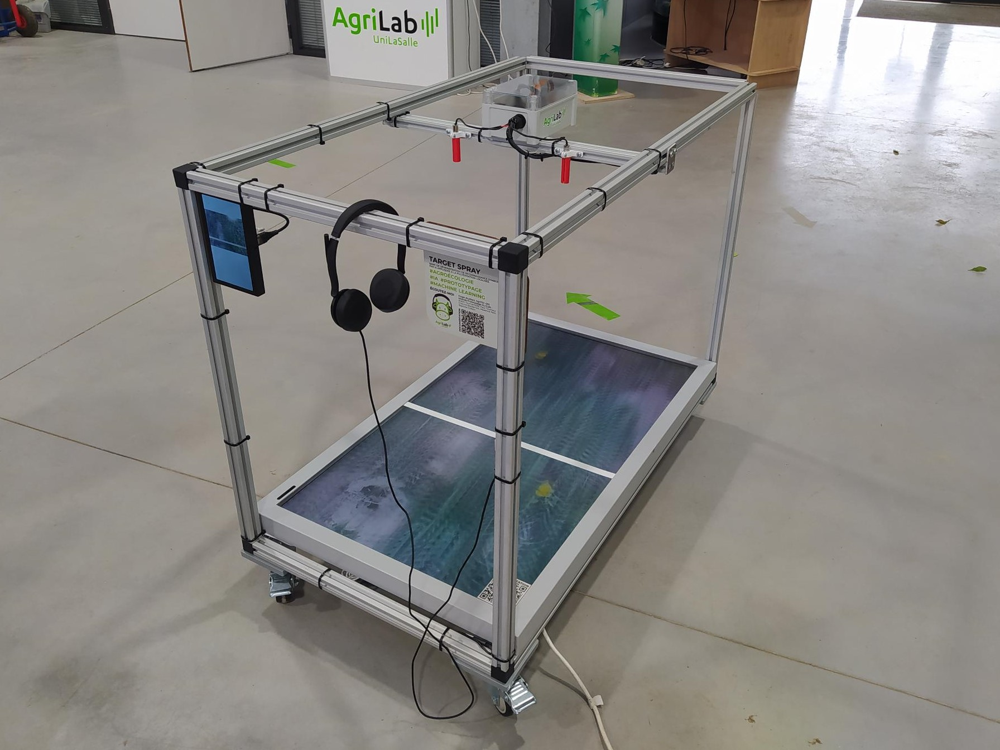

# Target Spray

## Contexte

Dans un monde où les enjeux environnementaux et la sécurité alimentaire sont de plus en plus pressants, l’agriculture doit évoluer vers des pratiques plus durables. La pulvérisation localisée émerge comme une technique innovante qui permet d'optimiser l'utilisation des intrants phytosanitaires.

Cette méthode consiste à appliquer des produits de protection des cultures uniquement sur les zones ciblées qui en ont besoin, plutôt que sur l'ensemble de la parcelle.

## Problématique

Comment développer des technologies de pulvérisation ciblée, combinant précision et accessibilité, pour réduire l'impact environnemental des intrants agricoles tout en répondant aux contraintes économiques et à la contraintes de transport ?

## Projet

Le projet a pour but de concevoir un prototype qui mettrait en évidence le fonctionnement de la pulvérisation localisée qui est indispensable pour une pulvérisation de précision.

## Besoins

Le target spray permet la réduction des produits phytosanitaires car on applique le produits à des zones ciblées.
Il y a aussi un impact économique car on applique du produits à des zones ciblées et pas dans la parcelle entières.

# [Planification](planification.md)

# [Contraintes](contraintes.md)

# [Cahier des charges](cahier-des-charges.md)

# [Veille concurrentielle](veille-concurrentielle.md)

# [Veille technologique](veille-technologique.md)

# [Conception banc de démonstration](conception-banc-de-demonstration.md)

# [Entrainement d'une intelligence artificielle](entrainement-d-une-intelligence-artificielle.md)

# [Budget](budget.md)

# [Solutions Techniques](solutions-techniques.md)

# [Code python et logiciel](code-python-et-logiciel.md)

# [Modification pour Salon/expo](modification-pour-salonexpo.md) (Par AgriLab)

## Crédits

Projet réalisé par des étudiants AgriTEC Promo 002 :
Robin Tournemolle
Paul Tourneur
Etienne Bontemps
Maxence Petit
Baptiste Colson

---

[← Retour au sommaire](../README.md)
