# 2D Inkscape

1. 2D Inkscape

https://inkscape.org/

quelques opérations

cercle

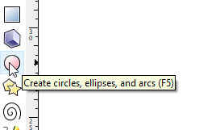


Faire des courbes de beziers


Dissocier des éléments


opération d'union de 2 courbes


opération de différences de 2 courbes


## 2D

Découpe Vinyle :

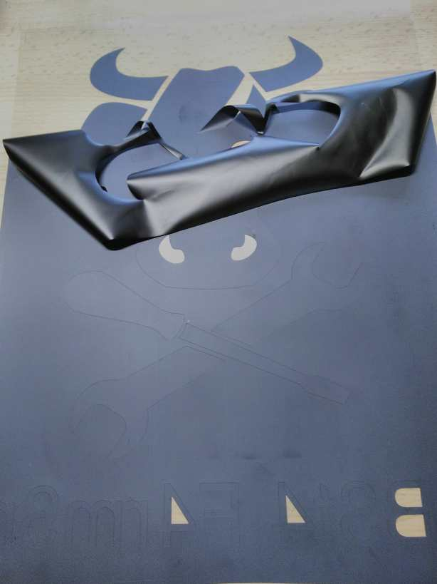

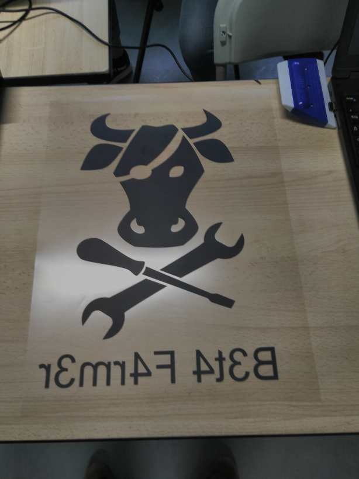

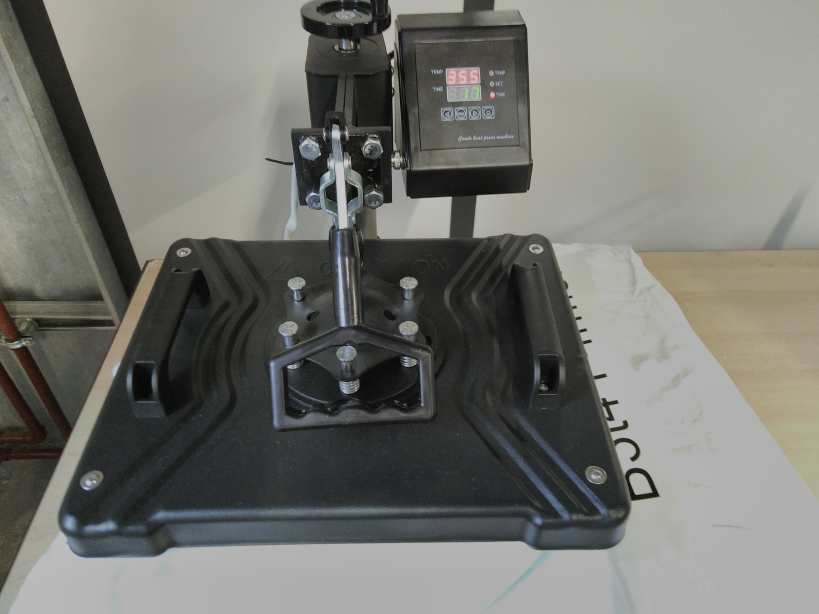

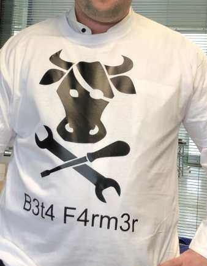

Fraisage / Moulage :

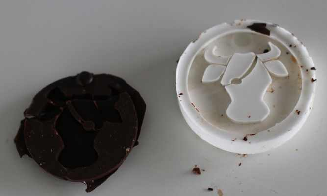

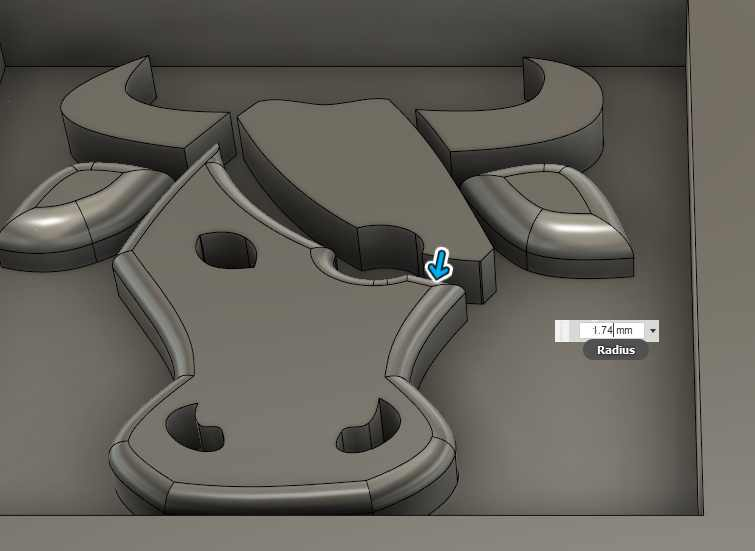

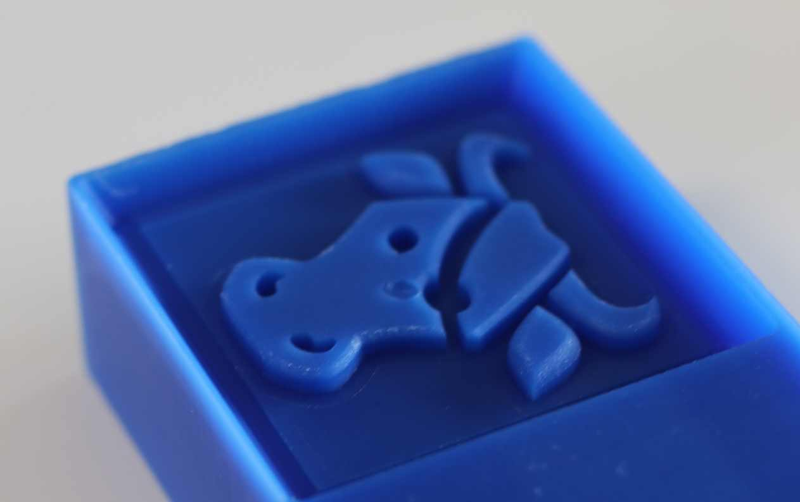

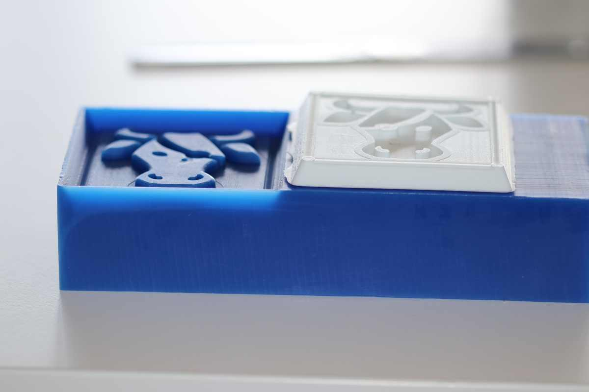

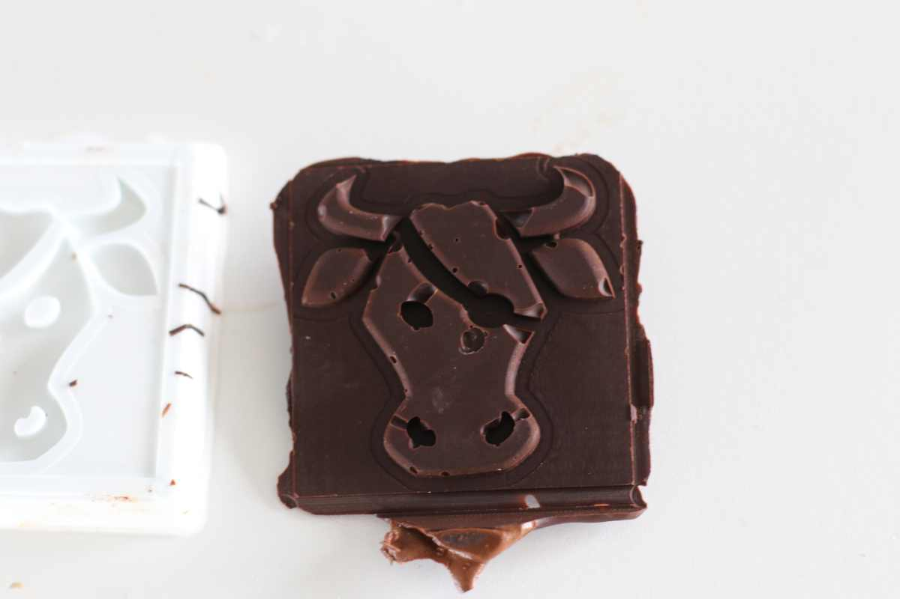

Fraisage :

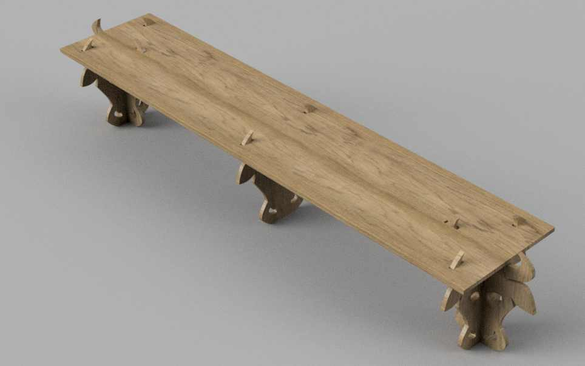

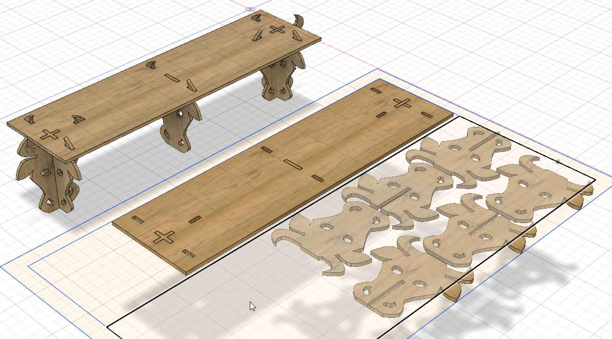

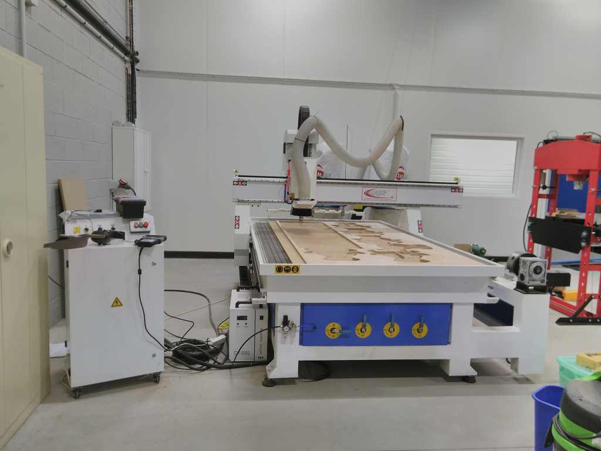

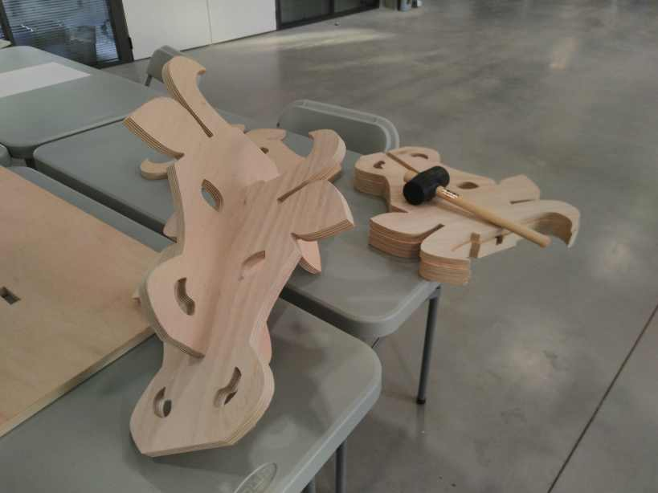

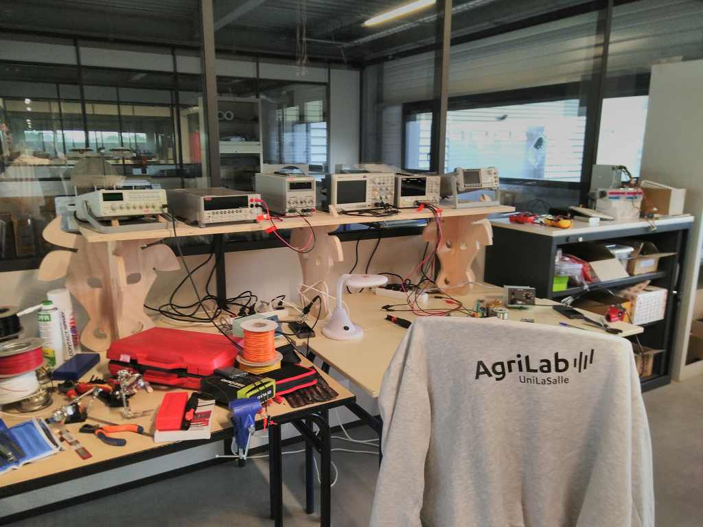

## Inkscape-plugins spécifique laser :

### Hershey Text

Hershey Text : https://www.evilmadscientist.com/2011/hershey-text-an-inkscape-extension-for-engraving-fonts/

Texte:
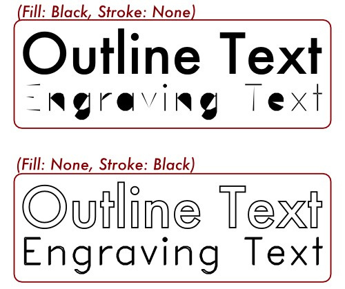
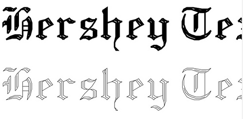
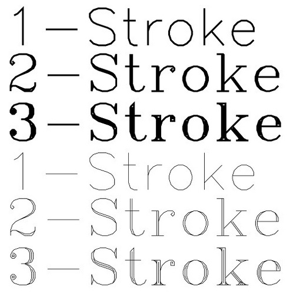
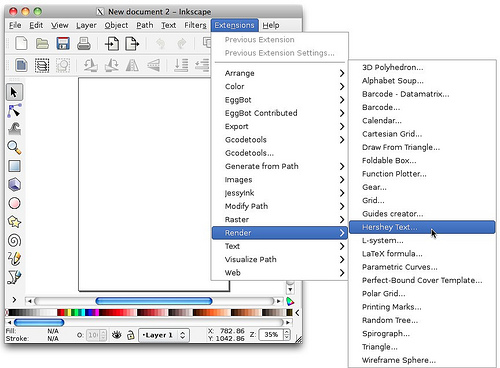

### BoxMaker

BoxMaker plugin for Inkscape : https://github.com/paulh-rnd/TabbedBoxMaker

installation :
```text
_## Installation
Boxmaker.inx, Schroffmaker.inx and Boxmaker.py need to be put in the inkscape extensions folder generally in:

`...\Inkscape\share\extensions `

or linux:

`usr/.../Inkscape/share/extensions`

(NOTE: you need to make boxmaker.py executable)_
```

### Eliptical Box Maker

Eliptical Box Maker plugin for Inkscape : https://github.com/BvdP/elliptical-box-maker

### Vectorize plugin

Vectorize plugin laser oriented for Inkscape : https://github.com/fablabnbg/inkscape-centerline-trace

Pour éviter d'avoir un "double trait" lors de la vectorisation.

### Halftone et moiré

https://xoihazard.com/tools/halftone/

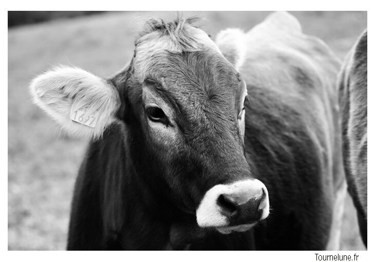

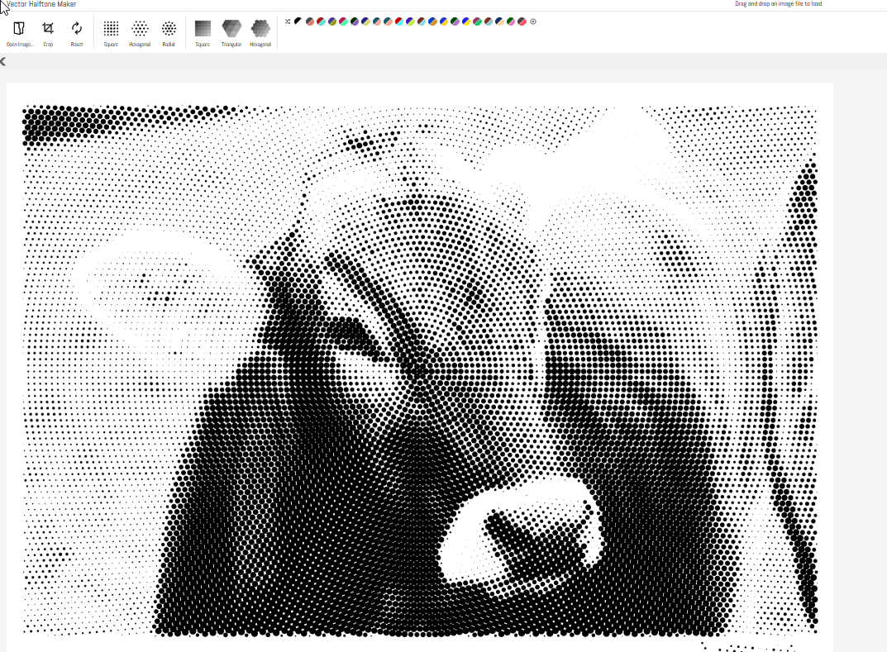

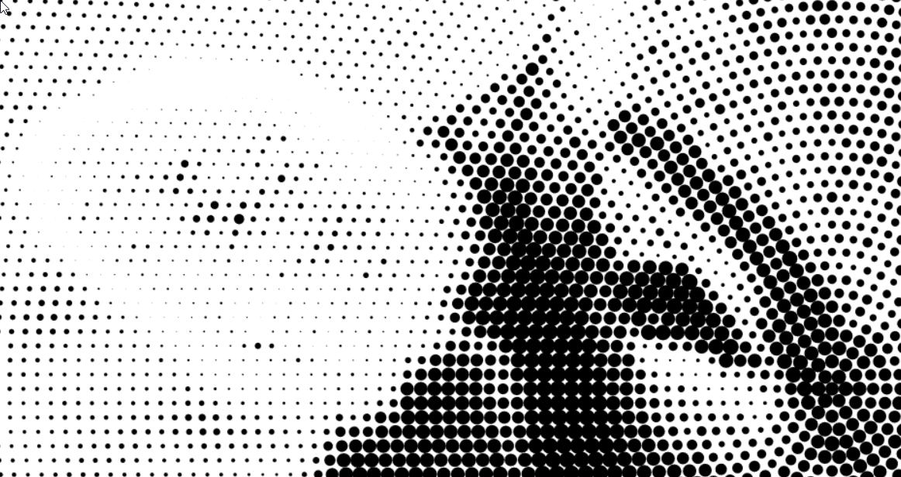

---

[← Retour à l’index](README.md)
