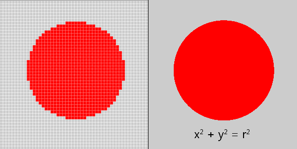

<!--
Projet Redmine : Tutoriels
Source : Question
ID source : 17
Section : Atelier de formations
Derniere modification : 2024-08-22 10:37:34
-->

# 2D Inkscape
## Déroulé

*Objectifs de l'atelier :*
* Comprendre les concepts fondamentaux du dessin vectoriel.
* Apprendre à utiliser Inkscape, un logiciel de dessin vectoriel open-source.
* Créer des illustrations simples en utilisant Inkscape.
* Appliquer les compétences acquises dans un exercice pratique.

*Matériel Nécessaire :*
* Ordinateur avec Inkscape installé (version la plus récente recommandée).
* Souris.


*Partie 1 : Introduction au Dessin Vectoriel*
*1. Définition du dessin vectoriel*
* Le dessin vectoriel est une méthode de création d'images basée sur des formules mathématiques. Les images vectorielles sont composées de trajectoires et de formes géométriques.
* Comparaison avec les images bitmap : Les images bitmap sont composées de pixels et sont appropriées pour les photographies, tandis que les images vectorielles sont idéales pour les illustrations et les logos.
* Avantages du dessin vectoriel
* Mise à l'échelle sans perte de qualité : Les images vectorielles peuvent être agrandies ou réduites sans perte de netteté.
* Flexibilité : Vous pouvez facilement éditer et modifier des objets vectoriels.
* Adaptabilité : Les images vectorielles fonctionnent bien à différentes résolutions et formats.

*2. Introduction à Inkscape*
* Démarrage d'Inkscape : Ouvrez le logiciel et expliquez les différentes zones de l'interface, y compris la barre d'outils, la zone de travail et la barre des propriétés.
* Navigation rapide : Montrez comment zoomer, déplacer la vue et revenir en arrière.

*Partie 2 : Les Outils de Dessin*
*1. Outil Sélection*
* Sélection d'objets : Montrez comment sélectionner un objet en cliquant dessus.
* Déplacement d'objets : Expliquez comment déplacer un objet en le faisant glisser.
* Redimensionnement : Montrez comment redimensionner un objet en tirant sur les poignées de redimensionnement.

*2. Outil Ligne*
* Création de lignes : Sélectionnez l'outil Ligne et montrez comment dessiner des lignes droites en cliquant et en faisant glisser.
* Propriétés de ligne : Expliquez comment modifier l'épaisseur et le style de ligne.

*3. Création de formes de base*
* Outil Forme : Utilisez l'outil de forme pour créer des cercles, des rectangles et d'autres formes de base.
* Personnalisation des formes : Montrez comment changer la couleur de remplissage et du contour des formes

*Partie 3 : Travailler avec les Trajectoires*
*1. Outil Plume (15 minutes)*
* Création de trajectoires : Utilisez l'outil Plume pour dessiner des trajectoires courbes en ajoutant des points d'ancrage et des poignées de contrôle.
* Modification des points d'ancrage : Expliquez comment ajuster la forme d'une trajectoire en déplaçant les points d'ancrage.

*2. Conversion d'objets en trajectoires*
* Montrez comment convertir une forme géométrique en trajectoire en utilisant l'option "Chemin" > "Objet en chemin".
* Expliquez pourquoi cela peut être utile pour la personnalisation.

*3. Modification des trajectoires*
* Nœuds et poignées de contrôle : Détaillez comment ajuster les trajectoires en déplaçant les nœuds et en manipulant les poignées de contrôle.
* Création de formes complexes : Montrez comment combiner des trajectoires pour créer des formes complexes.

*Partie 4 : Texte et calques*
*1. Ajout de texte*
* Utilisation de l'outil Texte : Montrez comment créer des zones de texte et ajouter du texte.
* Mise en forme du texte : Expliquez comment formater la police, la taille et la couleur du texte.

*2. Utilisation de calques*
* Gestion des calques : Montrez comment utiliser les calques pour organiser vos objets et les empiler de manière logique.

*Partie 5 : Opérations booléennes*
*1. Utilisation des opérations booléenne*
* Addition, soustraction division, etc de formes pour en créer de nouvelles.

*Partie 6 : Exportation*
*1. Exportation de vos dessins*
* Formats d'exportation : Expliquez comment exporter vos créations dans différents formats tels que PNG (raster), SVG (vectoriel), et PDF (pour l'impression).
* Paramètres d'exportation : Montrez comment choisir la résolution, la qualité, et d'autres paramètres d'exportation en fonction de l'usage prévu.

*Exercice Pratique*
*1. Exercice de dessin*
* Les étudiants sont invités à appliquer les compétences acquises pour créer une illustration simple (par exemple, une fleur, un logo, ou un symbole).
* L'instructeur circule pour aider les étudiants, répondre à leurs questions et fournir des conseils.

*Questions et Réponses*
*1. Session de questions*
* Les étudiants posent des questions sur le contenu du cours, les outils, ou l'exercice pratique.
* L'instructeur répond aux questions et partage des astuces supplémentaires.

*Conclusion*
*1. Récapitulation*
* Résumez les points clés du cours, mettant l'accent sur les avantages du dessin vectoriel et les compétences acquises.

*2. Ressources*
* Fournissez des ressources pour approfondir les compétences en dessin vectoriel, telles que des tutoriels en ligne, des livres recommandés, ou des communautés d'utilisateurs d'Inkscape.
### synthèse de déroulé :

* Type de logiciel vectoriel
* Vecteur vs pixel
* Vecteur et machine G-code
** Exemple sur les différents type de machine : laser, brodeuse, extrusion 3D, CNC, ...
* Formes simples : carré, rond, polygone
* Resize, positionnement, rotation de la forme, propriété
* Alignement et distribution
* Courbe de bézier
** *Orientation du vecteur !*
* couleur courbe , couleur remplissage
* Opération Booleenne
** Notion dessus-dessous
** Importance du remplissage de couleur,comme aide, à relier à la notion vecteur machine g-code
* Importation image bitmap
** Exercice pratique courbe de bézier en déclaque
** Vectorisation et problème, quelques réglages (décourager la pratique de la vectorisation- c'est magique)
* Retouche de vecteur trouvé sur internet :
** dégrouper
** scinder les courbes
** opérations sur les courbes
* Texte
** Font vs vecteur : accident à l'export
** notion du double trait à la laser
* export en SVG et en DXF
** unité mm et inch
** réouverture dans un autre logiciel, type laser axe et démonstration des problèmes courants : groupe, police texte ...

* Plugins
** Boite
** font Hershey

* autres logiciels et combinaisons de techniques
** "Logiciels 2D":/projets/projects/tutoriels/questions/100-logiciels-2d
** https://cuttle.xyz/ [[https://cuttle.xyz/]] , https://fabacademy.org/2021/labs/waag/students/nadieh-bremer/blog/week-3/


* Nesting
** notion : SVG nest : https://svgnest.com/test/
** deepnest : https://deepnest.io/
## Contenu

https://inkscape.org/




quelques opérations

cercle


!{width:300px}http://agrilab.unilasalle.fr/projets/attachments/download/1328/inkscape-002_ellipse.png!

Faire des courbes de beziers

!{width:300px}http://agrilab.unilasalle.fr/projets/attachments/download/1325/inkscape-003b_curve.png!

!{width:300px}http://agrilab.unilasalle.fr/projets/attachments/download/1327/inkscape-003_curve.png!

Dissocier des éléments

!{width:300px}http://agrilab.unilasalle.fr/projets/attachments/download/1324/inkscape-004_break_appart.png!

!{width:300px}http://agrilab.unilasalle.fr/projets/attachments/download/1323/inkscape-004b_break_appart.png!

opération d'union de 2 courbes

!{width:300px}http://agrilab.unilasalle.fr/projets/attachments/download/1321/inkscape-005_union.png!

!{width:300px}http://agrilab.unilasalle.fr/projets/attachments/download/1322/inkscape-005b_union.png!

opération de différences de 2 courbes

!{width:300px}http://agrilab.unilasalle.fr/projets/attachments/download/1320/inkscape-006_difference.png!

!{width:300px}http://agrilab.unilasalle.fr/projets/attachments/download/1319/inkscape-006b_difference.png!
## orientation du vecteur


## 2D

Découpe Vinyle :


Fraisage / Moulage :


Fraisage :


## Inkscape-plugins spécifique laser :
### Hershey Text

Hershey Text : https://www.evilmadscientist.com/2011/hershey-text-an-inkscape-extension-for-engraving-fonts/

Texte:


### BoxMaker

BoxMaker plugin for Inkscape : https://github.com/paulh-rnd/TabbedBoxMaker

installation :
<pre><code class="text">
_## Installation
Boxmaker.inx, Schroffmaker.inx and Boxmaker.py need to be put in the inkscape extensions folder generally in:

`...\Inkscape\share\extensions `

or linux:

`usr/.../Inkscape/share/extensions`

(NOTE: you need to make boxmaker.py executable)_

```

### Eliptical Box Maker

Eliptical Box Maker plugin for Inkscape : https://github.com/BvdP/elliptical-box-maker
### Vectorize plugin

Vectorize plugin laser oriented for Inkscape : https://github.com/fablabnbg/inkscape-centerline-trace

Pour éviter d'avoir un "double trait" lors de la vectorisation.


Exemple de plusieurs techniques : 

https://wiki.imal.org/project/fox-variations

Objet 3D en plusieurs couches :

https://wiki.imal.org/project/you-are-lucky-me

Machine à calculer :

https://wiki.imal.org/project/calculus
