# Atelier Brodeuse Numérique

1. Atelier Brodeuse Numérique

+PRIX+ :
>>>Tambour 200mmx200mm --> 2€/broderie
>>>Tambour 100mmx100mm --> 1,50€/broderie
>>>Autres tambours --> 1€/broderie

*+1) Logiciel de la brodeuse+*

>>>>+a) Pe-Design :+ logiciel payant - 1 seule licence à AgriLab

- Lorsque vous arrivez sur la page d'accueil, cliquez sur "Définir la taille du tambour et le tissu" et sélectionnez ensuite la machine et la taille de votre tambour puis cliquez sur OK.
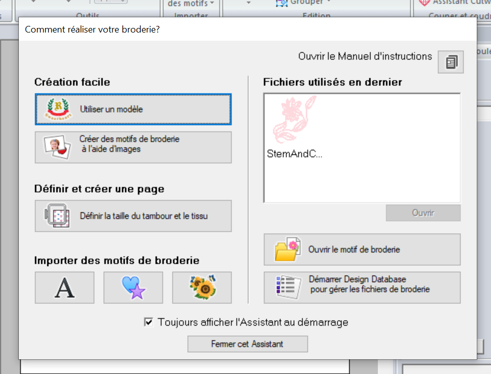

- Choisissez ensuite votre tissu (ou la matière qui s'en rapproche le plus, de toute façon cela n'a pas réellement d'incidence sur le résultat final)

- Dans le bandeau à droite de la page, vous pouvez :
>>>>>>>>-->importer différents motifs déjà présents dans le logiciel
>>>>>>>>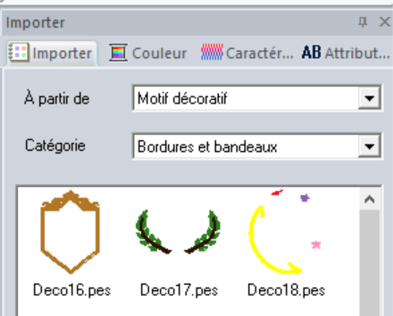

>>>>>>>>-->choisir la couleur des fils (même si vous aurez à changer les bobines manuellement sur la brodeuse, choisissez une couleur qui se rapproche le plus de celle que vous souhaitez pour mieux visualiser le rendu final)
>>>>>>>>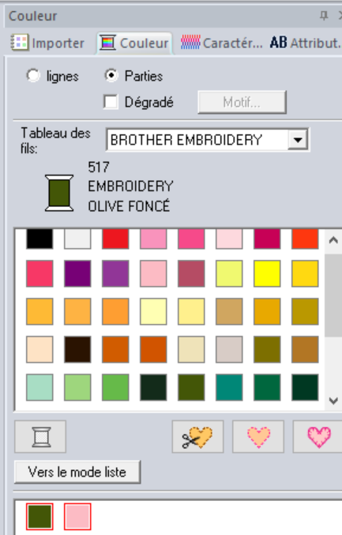

>>>>>>>>-->*L'onglet "Caractéristiques" est très important. Il permet de choisir les paramètres de votre borderie*
Dans "Couture de Ligne", choisissez l'épaisseur que vous souhaitez dans "Largeur zigzag"
Dans "Broderie des parties", choisissez la densité (compter 7points/mm pour un rendu plein) et l'orientation du fil
>>>>>>>>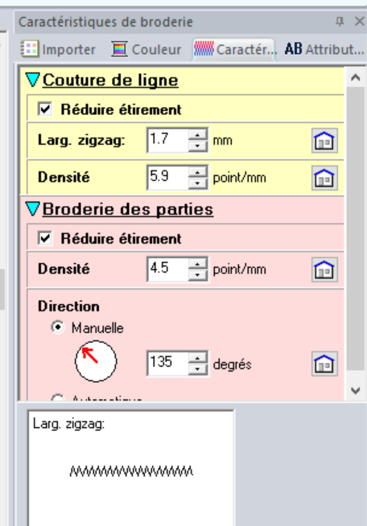

- Dans la barre de menu, onglet "Afficher", vous avez différentes manières de visualiser votre motif (cf image ci-dessous) :
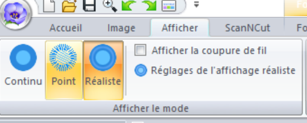

- Tout à gauche de l'écran, vous avez l'ordre de broderie (si ce n'est pas le cas, retournez dans la barre de menu "Afficher" et sélectionnez "Ordre de Broderie" qui doit apparaître surligné orangé.) *L'agencement de votre broderie est important, il vous permet de ne pas à avoir à changer manuellement vos bobines trop souvent sur la brodeuse.*
Pour cela, cliquez sur les 3 petits carrés "Optimiser l'ordre de broderie" comme sur l'image ci-dessous (si l'image est grisée, sélectionnez vos différents motifs) :
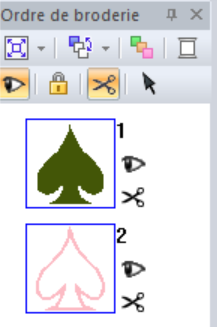
Vous pouvez également déplacer vos motifs manuellement, selon l'ordre que vous souhaitez.

- Sélectionnez votre motif, l'onglet "Formes" apparaît alors dans votre barre de menu. Vous pouvez choisir votre point de tige ou votre point de remplissage

-Si vous souhaitez mettre des motifs de remplissage, cliquez dans la barre de menu "Formes"--> "Motif Remplissage Programmé" puis choisissez sur la droite le motif de remplissage que vous souhaitez
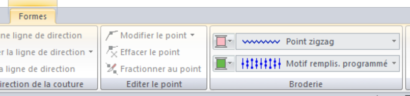

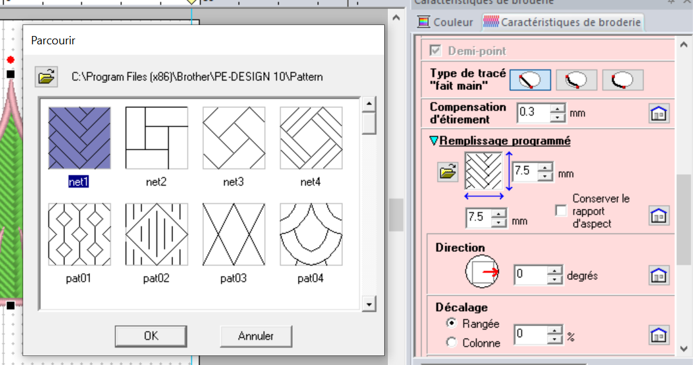

- Une fois votre motif terminé, allez sur la fleur tout en haut à gauche de Pe-Design et cliquez sur "Exporter"

>>>>+b) Ink/Stitch :+ Extension open source d'Inkscape - téléchargeable depuis n'importe quel ordinateur

Pour télécharger Inkscape :https://inkscape.org/fr/release/0.92.3/
Pour télécharger Ink/stitch : https://inkstitch.org

Une fois l'installation faite, il faut procéder pas à pas.

- Dessinez votre motif sur Inskape
- Sélectionnez la forme puis aller dans "Chemin" --> "Objet en chemin" ou "Contour du chemin" si vous ne souhaitez broder que les contours de la forme

Si vous oubliez cette étape vous aurez un message d'erreur du type :
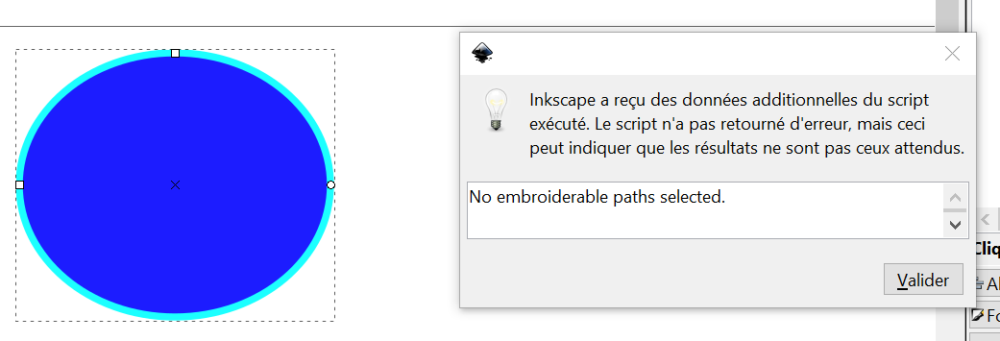

- Aller ensuite dans "Extensions" --> "Ink/Stitch --> "paramètres", un aperçu de la broderie apparaît selon des paramètres par défaut
- Faites jouer tous les paramètres dans les onglets "Stroke" et "AutoFill" pour voir à quoi ils correspondent.

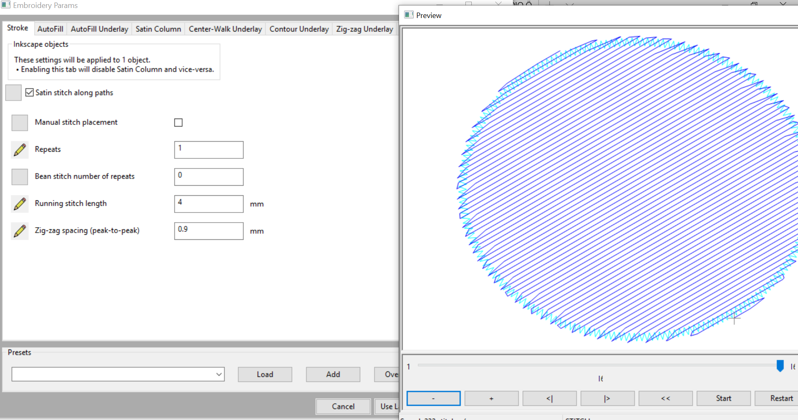

- Une fois vos paramètres choisis, aller "Extensions" --> "Ink/Stitch" --> "Broder"

- Enregistrez au format .PES
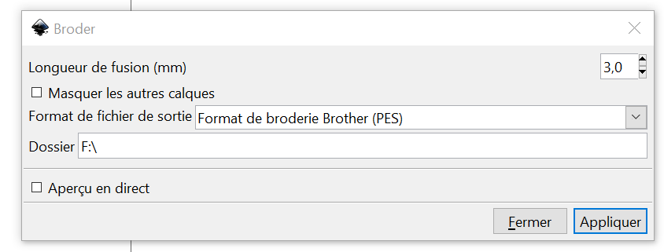

*+2) Utilisation de la brodeuse+*

*Attention : ne pas mettre où l'aiguille passe !
Attention : Pensez à huiler au niveau de la canette et au dessus de l'aiguille* (se référer à la notice)

- Appliquer le support côté brillant sur le tissu avec le fer à repasser
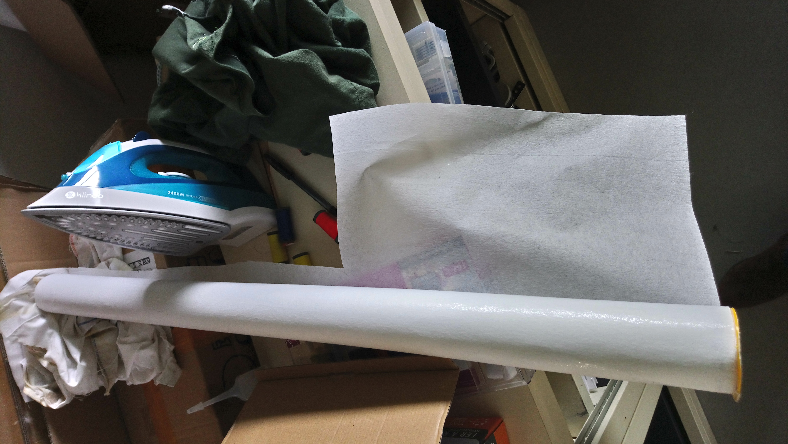

- Coincer le tissu à broder dans le tambour, sans faire de pli, en étirant le tissu au maximum

- Allumer la brodeuse

- Sur le menu de la brodeuse, il est possible de visualiser différents points :

>>>>>--> Vitesse de broderie par défaut : 1000spm = 1000 points/min (possibilité de réduire la vitesse)
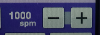
>>>>>--> Nombre de points restants par rapport au nombre de points finaux, temps de réalisation, nombre de couleurs
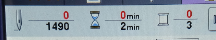
>>>>>--> Pour voir les dimensions de la broderie, et les cadres de broderie qui peuvent convenir
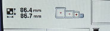
>>>>>--> Si le fil casse, pour revenir quelques points en arrière
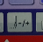

---

[← Retour à l’index](README.md)
