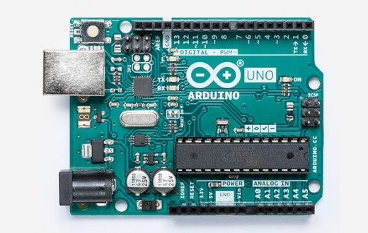
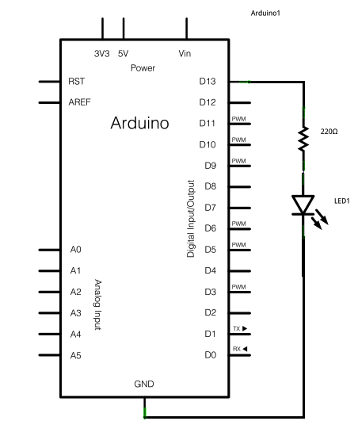
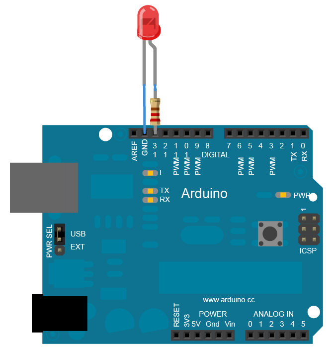

<!--
Projet Redmine : Tutoriels
Source : Question
ID source : 14
Section : Atelier de formations
Derniere modification : 2022-11-24 15:33:26
-->

# Introduction Arduino

niveau 1 : Lecture/ écriture digitale
## Déroulé

* Descritpiton de l'éco-système Arduino
* Prise en main de la carte, installation du logiciel
* Uploader un premier code : blink
** Modifier le code et comprendre les modifications
** Structure du code loop() , setup() , commentaires, couleur des mots clés, digitalWrite()
** Comprendre les tolérances physiques : tension/courant des entrées-sorties , pinMode() 
** Pourquoi résistance : courant tension, loi d'ohm
* Utilisation multimètre, mesure tension, résistance
* Exercice : Faire clignoter différemment deux LEDS
* Schéma bouton, code lecture bouton
** Lire l'état d'un bouton digitalRead() et l'afficher avec SerialPrint()
** Résistance, ou placer le input ? (courant, court-circuit)
* Combiner deux exercices : bouton et LED
## Contenu illustratif



Site principal : [[https://www.arduino.cc]]

Logiciel : [[https://www.arduino.cc/en/Main/Software]]

Tutoriel officiel : [[https://www.arduino.cc/en/Tutorial/HomePage]]

Ressources, toutes les commandes : [[https://www.arduino.cc/reference/en/]]


Exemple de code :

<pre><code class="c">

/*
  Blink
  Turns an LED on for one second, then off for one second, repeatedly.
*/

// the setup function runs once when you press reset or power the board
void setup() {
  // initialize digital pin LED_BUILTIN as an output.
  pinMode(LED_BUILTIN, OUTPUT);
}

// the loop function runs over and over again forever
void loop() {
  digitalWrite(LED_BUILTIN, HIGH);   // turn the LED on (HIGH is the voltage level)
  delay(1000);                       // wait for a second
  digitalWrite(LED_BUILTIN, LOW);    // turn the LED off by making the voltage LOW
  delay(1000);                       // wait for a second
}


```


Schéma électronique correspondant




## Pinout Arduino Uno


## Code couleur résistance


## Schémats

LED


Bouton


## Code

Inversion du sens pendant 5 secondes

<pre><code class="c">
void setup() {
pinMode(2, OUTPUT);
pinMode(3, OUTPUT);

}

void loop() {
  digitalWrite(2, HIGH);
  digitalWrite(3, LOW);
  delay(5000);
  digitalWrite(2, LOW);
  digitalWrite(3, HIGH);
  delay(5000);

}

```


Vitesse progressive

<pre><code class="c">
void setup() {
pinMode(2, OUTPUT);
pinMode(3, OUTPUT);

}

void loop() {
  digitalWrite(2, HIGH);
  analogWrite(3, 100)
  delay(5000);
  digitalWrite(2, HIGH);
  analogWrite(3, 150)
  delay(5000);
  digitalWrite(2, HIGH);
  analogWrite(3, 200)
  delay(5000);
  digitalWrite(2, HIGH);
  analogWrite(3, 255)
  delay(5000);  
}

```


Autocompletion.


### Remerciements:

Ce projet est cofinancé par l'Union Européenne avec le fond Européen de Développement (FEDER) région Haut-de-France et AgriLab UniLaSalle , dans le cadre de l'OpenLab.
!http://agrilab.unilasalle.fr/wp-content/uploads/2019/11/Logo-UE-SD.jpg! !http://agrilab.unilasalle.fr/wp-content/uploads/2019/11/FEDER-SD.png! !{width:300px}http://fab.academany.org/2021/labs/agrilab/images/about/agrilabLogo.jpg!
