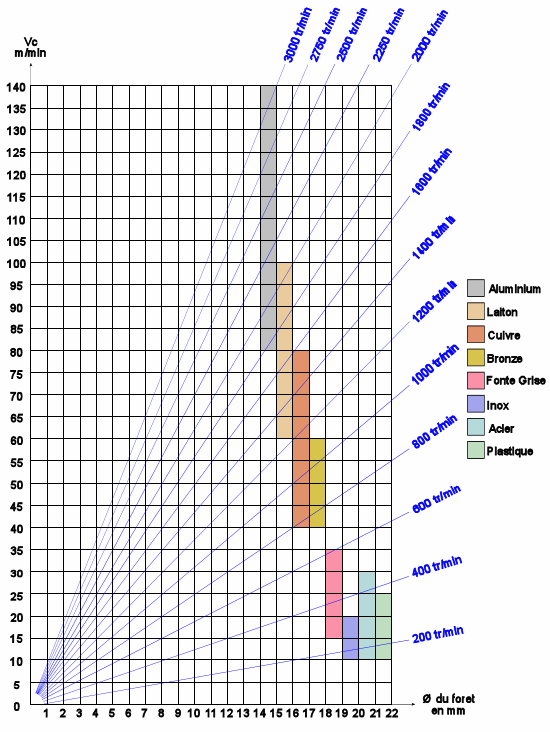

# Vitesse perçage

1. Vitesse perçage

1. +_*Avant de penser à la vitesse de rotation de la perceuse, s’assurer que les forets qui seront utilisés soient bien affûtés et adaptés au matériau à percer.*_+

Une petite formule pour calculer la vitesse de rotation d’une perceuse dans un matériau donné :

N = 1000 x Vc / 3,14 x D

N = nombre de tours par minute D= diamètre du foret Vc = vitesse de coupe (conseillé par les fabricants de matériaux)

Quelques vitesses de coupe à l’aide de foret HSS (Variables suivant les sources) : Plastique : 10 à 20 m / min Acier : 15 à 25 m / min Acier inox : 15 à 20 m / min Fonte grise : 15 à 30 m / min Bronze : 40 à 60 m / min Cuivre : 40 à 80 m / min Laiton : 60 à 100 m / min Aluminium : 80 à 140 m / min

Plus simple que le calcul, un abaque

Pour percer des trous d’un diamètre supérieur à 5/6 mm dans de la tôle mince, privilégier l’usage de forets étagés (en forme de cône) qui existent en plusieurs diamètres de manière à obtenir des trous parfaitement ronds.

Pour percer des trous dans le bois, utiliser les mèches avec pointe de centrage et coupe fibres (3 pointes !) ou les mèches plates. La vitesse sera adaptée de manière à ce que les copeaux ne brulent et n’adhèrent sur les tranchants de la mèche.

---

[← Retour à l’index](README.md)
