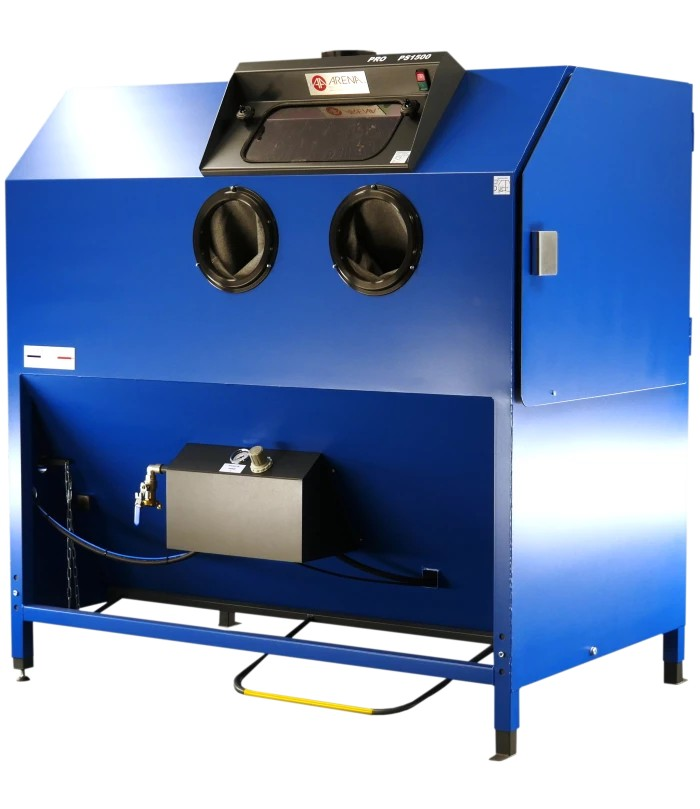
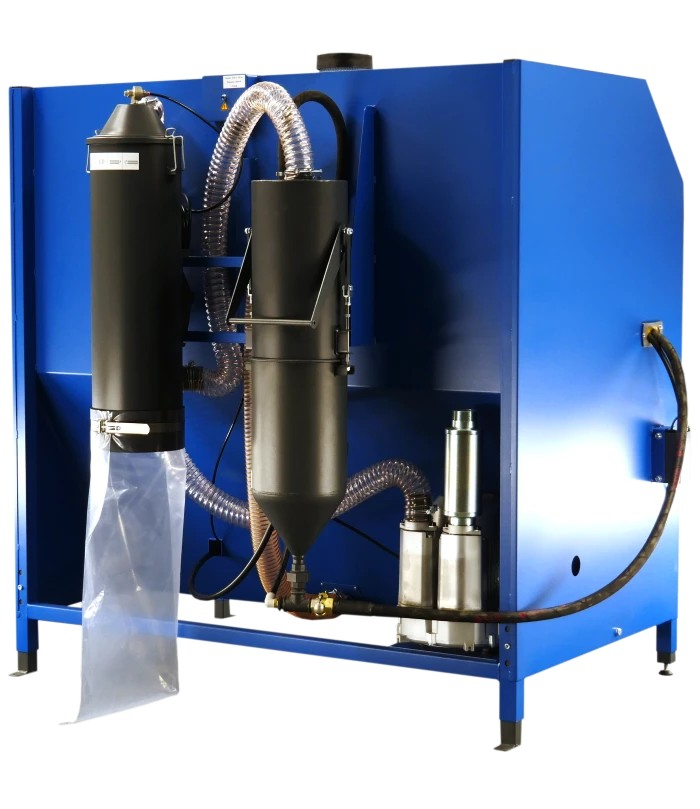

<!--
Projet Redmine : Tutoriels
Source : Question
ID source : 267
Section : Machines
Derniere modification : 2026-05-26 15:10:38
-->

# Cabine de sablage - PS 1500 ArenaBlast

Cabine de sablage - PS 1500 ArenaBlast

[Page produit](https://arenablast.com/fr/gamme-pro/169-ps-1500.html)
[Guide des abrasifs](https://arenablast.com/fr/content/15-abrasifs-pour-sablage)
# Cabine de sablage ArenaBlast PS-1500
## Description générale

La *PS-1500* est une cabine de sablage professionnelle de la gamme ArenaBlast, conçue pour le traitement de surface de pièces métalliques ou composites par projection d’abrasif sous pression.

À Agrilab, cette machine est utilisée pour :
* le décapage de pièces métalliques,
* la préparation de surface avant peinture, soudure ou collage,
* le nettoyage de pièces mécaniques,
* la restauration et la finition de prototypes.

La PS-1500 appartient à la gamme *Pro* ArenaBlast, caractérisée par une construction renforcée, une étanchéité élevée et une ergonomie adaptée à un usage intensif.
## Principe de fonctionnement

Le sablage consiste à projeter un abrasif à grande vitesse à l’aide d’air comprimé sur une surface à traiter.

Le système comprend :
* une cabine fermée étanche,
* un pistolet de sablage,
* un circuit d’air comprimé,
* un circuit de récupération de l’abrasif,
* un système de filtration des poussières.

L’opérateur manipule les pièces à l’intérieur de la cabine à l’aide de gants intégrés et contrôle le jet d’abrasif via la gâchette du pistolet.
## Caractéristiques techniques principales
### Dimensions et capacité
* Largeur utile intérieure : environ 1500 mm
* Cabine adaptée aux pièces de grande taille
* Accès frontal par porte
### Construction
* Châssis en acier soudé
* Cabine étanche avec joints renforcés
* Vitre de visualisation protégée par films remplaçables
* Éclairage intérieur intégré
### Système de filtration
* Filtration des poussières par cartouche ou cyclone selon configuration
* Maintien de la visibilité pendant le sablage
* Récupération et recyclage de l’abrasif
### Alimentation
* Fonctionnement à l’air comprimé
* Pression de travail dépendante de l’abrasif et du matériau
* Compresseur externe requis

Les performances finales dépendent directement du débit et de la qualité de l’air comprimé fourni.
## Abrasifs de sablage

La cabine ArenaBlast PS-1500 est compatible avec l’ensemble des abrasifs secs utilisés en sablage et microbillage, à condition qu’ils soient propres, secs et adaptés au circuit de récupération.

Le choix de l’abrasif dépend :
* du matériau de la pièce,
* de l’objectif (décapage, nettoyage, finition),
* de la rugosité souhaitée,
* de la fragilité de la surface.
### Familles d’abrasifs
#### Abrasifs minéraux

*Corindon brun*  
Abrasif anguleux à base d’oxyde d’aluminium.
* Décapage rapide des aciers
* Préparation de surface avant peinture ou thermolaquage
* Usage intensif

*Corindon blanc*  
Abrasif plus pur et plus friable que le corindon brun.
* Finition plus fine
* Inox, aluminium, pièces sensibles
* Moins agressif

*Grenat*  
Abrasif naturel anguleux.
* Décapage polyvalent
* Faible production de poussières
* Bonne longévité
#### Abrasifs métalliques

*Grenaille acier*  
Abrasif sphérique ou anguleux en acier.
* Décapage lourd
* Grenaillage de structures acier
* Très recyclable
#### Abrasifs non métalliques

*Billes de verre*  
Abrasif sphérique non agressif.
* Satinage
* Nettoyage sans enlèvement de matière
* Finition esthétique

*Microbilles céramique*  
Abrasif très homogène.
* Finition de précision
* Inox, aluminium
* Aspect visuel uniforme

*Bicarbonate de soude*  
Abrasif soluble et très doux.
* Nettoyage sans abrasion
* Aluminium, composites, pièces fragiles
* Non adapté aux circuits de recyclage classiques

*Coques de noix*  
Abrasif organique.
* Nettoyage de surfaces délicates
* Bois, plastiques, moules
* Très faible abrasion
### Tableau abrasifs et usages recommandés

| Abrasif | Matériaux compatibles | Usage principal | Niveau d’agressivité |
| Corindon brun | Acier, fonte | Décapage, préparation peinture | Élevé |
| Corindon blanc | Inox, aluminium | Décapage fin, finition | Moyen |
| Grenat | Acier, inox | Décapage polyvalent | Moyen |
| Grenaille acier | Acier | Grenaillage, décapage lourd | Très élevé |
| Billes de verre | Inox, aluminium | Satinage, nettoyage | Faible |
| Microbilles céramique | Inox, aluminium | Finition esthétique | Très faible |
| Bicarbonate de soude | Aluminium, composites | Nettoyage doux | Très faible |
| Coques de noix | Bois, plastiques | Nettoyage sans abrasion | Très faible |
### Bonnes pratiques de choix des abrasifs

* Toujours commencer avec l’abrasif le moins agressif possible
* Adapter la pression d’air à l’abrasif utilisé
* Ne jamais mélanger deux abrasifs différents
* Tamisage régulier pour éviter les corps étrangers
* Remplacer l’abrasif lorsqu’il devient trop fin ou pollué
### Compatibilité avec la PS-1500

La PS-1500 est conçue pour fonctionner de manière optimale avec :
* des abrasifs secs,
* des granulométries homogènes,
* un système de récupération propre.

Les abrasifs très fins ou solubles doivent être utilisés avec prudence et peuvent nécessiter un nettoyage complet du circuit après usage.
## Sécurité
### Équipements de protection individuelle
* Lunettes de protection
* Gants de manutention
* Masque anti-poussières lors de la maintenance
* Protection auditive si environnement bruyant
### Règles essentielles
* Ne jamais ouvrir la cabine en cours de sablage
* Vérifier l’état des gants et joints avant utilisation
* Ne pas sabler de matériaux contenant de l’amiante ou substances toxiques
* Ne jamais utiliser d’abrasifs humides
## Maintenance
### Maintenance courante
* Nettoyage régulier de la cabine
* Vérification de l’état des gants
* Remplacement des films de protection de la vitre
* Vidange et tamisage de l’abrasif
### Système de filtration
* Nettoyage ou remplacement des filtres
* Contrôle du débit d’aspiration
* Vérification de l’étanchéité du circuit de poussières

Toute opération de maintenance doit être réalisée machine à l’arrêt et circuit d’air dépressurisé.
## Bonnes pratiques à Agrilab

* Toujours choisir l’abrasif le moins agressif possible
* Tester le réglage sur une pièce d’essai
* Adapter la pression à la fragilité de la pièce
* Nettoyer la pièce après sablage avant toute opération ultérieure
* Documenter l’abrasif et les réglages utilisés dans le projet
## Ressources

* Fiche produit ArenaBlast PS-1500
* Documentation gamme Pro ArenaBlast
* Guide des abrasifs pour sablage ArenaBlast
## Responsabilité

L’utilisation de la cabine de sablage PS-1500 est réservée aux utilisateurs formés et autorisés.

En cas de doute sur un abrasif, un réglage ou un matériau, l’utilisation doit être interrompue et un FabManager contacté.
