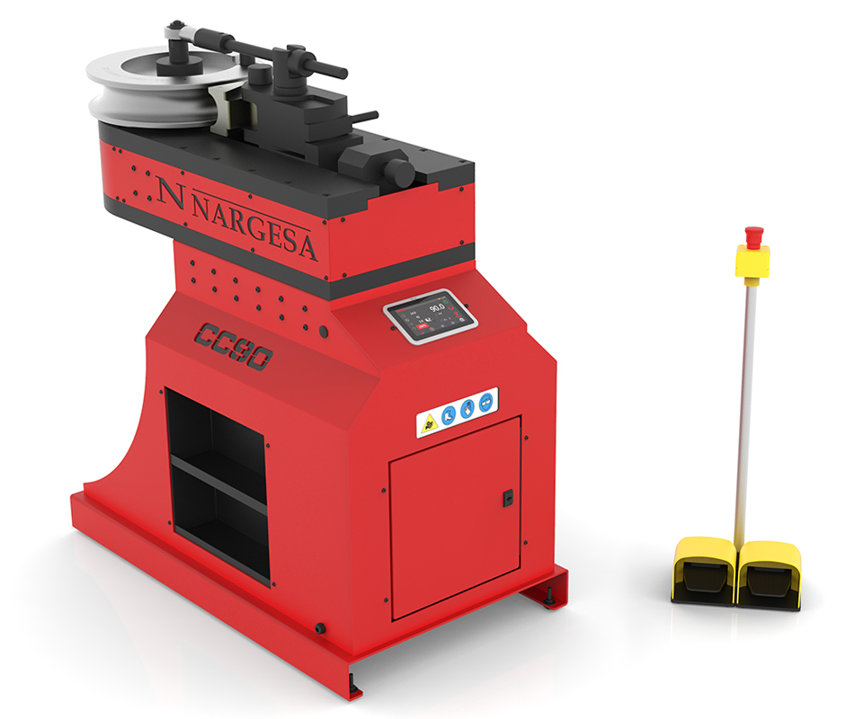

<!--
Projet Redmine : Tutoriels
Source : Question
ID source : 265
Section : Machines
Derniere modification : 2026-05-26 14:54:33
-->

# Cintreuse à enroulement - CC90CNC Nargesa

Cintreuse à enroulement - CC90CNC Nargesa

[Page produit](https://nargesa.com/fr/machines-industrielles/plieuses-hydrauliques-mp1500cnc?_gl=1*1lihwie*_up*MQ..*_ga*MjAxMDE0MjY0Ni4xNzc5Nzk2ODE4*_ga_ZBFLFG5XBP*czE3Nzk3OTY4MTckbzEkZzEkdDE3Nzk3OTY4NjckajEwJGwwJGgwJGQ1MmF1NkxqNGNDNGYyaWVTbGNIQktfZVp3MUswS1o2b2FR)

[Manuel d'utilisation](https://agrilab.unilasalle.fr/projets/attachments/download/8098/manuel-dinstructions-cc90cnc.pdf)
# Cintreuse à tubes sans mandrin CC90CNC
## Description générale

La *CC90CNC* est une cintreuse à tubes sans mandrin pilotée par commande numérique, conçue pour le cintrage précis et répétable de *tubes ronds et tubes carrés* en acier, inox ou aluminium.

À Agrilab, cette machine est utilisée pour :
* le prototypage de structures tubulaires,
* la fabrication de pièces unitaires ou de petites séries,
* des projets pédagogiques avancés nécessitant un cintrage contrôlé et répétable.

La CC90CNC permet le cintrage jusqu’à 180 degrés, avec une gestion fine des paramètres matière et une répétabilité adaptée à la production.
## Principe de fonctionnement

Le cintrage est réalisé par enroulement du tube autour d’une *forme* (matrice), sans mandrin interne.

Les éléments principaux sont :
* la *forme* (matrice de cintrage),
* la *contre-forme* ou galets porteurs,
* la *bride d’entraînement* assurant la rotation du tube,
* le *positionneur* de contre-forme,
* la *barre de renfort* selon le type et la section du tube.

Le tube est serré puis entraîné en rotation autour de la forme.  
La contre-forme limite l’écrasement, le glissement et la déformation de la section pendant le cintrage.

Le rayon minimal recommandé est égal à trois fois la dimension extérieure du tube (diamètre pour les tubes ronds, côté pour les tubes carrés).
## Caractéristiques techniques principales
### Dimensions et masse
* Dimensions : 700 × 1300 × 1360 mm
* Masse : environ 860 kg
### Motorisation
* Puissance moteur : 2,2 kW (3 CV)
* Vitesse de rotation automatique : de 0,75 à 2,2 tr/min
* Angle de cintrage maximal : 180 degrés
### Alimentation électrique
* Tension : 230 / 400 V triphasé
* Fréquence : 50/60 Hz
* Intensité nominale : 9 A / 5 A

Toute intervention sur le branchement électrique doit être réalisée machine hors tension.
## Capacités de cintrage
### Tubes ronds
* Diamètre maximal : jusqu’à 90 mm
* Tubes standards : jusqu’à 3 pouces Schedule
* Rayon de cintrage minimal : 3 fois le diamètre du tube
### Tubes carrés
* Sections compatibles : de 20 × 20 mm à 50 × 50 mm
* Épaisseur typique : de 1,5 mm à 5 mm selon la section
* Rayon minimal recommandé : environ 5 fois la dimension extérieure du tube

Les capacités réelles dépendent :
* du matériau,
* de l’épaisseur,
* du rayon de la forme utilisée,
* de l’utilisation ou non de la barre de renfort.
## Interface de commande CNC
### Éléments de commande
* Écran tactile couleur
* Sélecteur mode manuel / automatique
* Réglage du diamètre ou de la section
* Réglage du rayon de forme
* Réglage de l’épaisseur du matériau
* Réglage de l’angle de cintrage
* Commandes de rotation droite et gauche
* Compteur de pièces
* Déblocage automatique
* Arrêt d’urgence
### Paramètres pilotés
* Diamètre ou section du tube
* Rayon de la forme
* Épaisseur du tube
* Angle de cintrage
* Vitesse de travail
* Correction d’angle
* Nombre de répétitions
## Modes de fonctionnement
### Mode manuel

Le mode manuel permet :
* la saisie directe des paramètres de cintrage,
* la réalisation de cintrages simples,
* les essais matière,
* le réglage spécifique des tubes carrés.

Ce mode est recommandé pour les premiers cintrages d’un nouveau matériau ou d’une nouvelle section.
### Correction de l’angle

Une correction d’angle peut être appliquée pour compenser le retour élastique du matériau.

Cette correction dépend fortement :
* du matériau,
* de la section (tube rond ou carré),
* de l’épaisseur.

Elle doit être validée par essais.
### Mode automatique

Le mode automatique permet :
* la création de programmes comprenant plusieurs cintrages,
* l’enregistrement de programmes réutilisables,
* la répétition de séquences avec angles différents sur une même pièce.

Les paramètres de section et de matériau sont communs à l’ensemble du programme.
## Sens de rotation

La CC90CNC permet le cintrage dans les deux sens de rotation.

Avant toute modification du sens de rotation :
* retirer le tube,
* démonter la contre-forme et la bride d’entraînement,
* repositionner la forme à zéro via la CNC.

Le sens de rotation modifie uniquement la direction de cintrage, pas les paramètres du programme.
## Barre de renfort

La barre de renfort est obligatoire pour :
* les tubes ronds de grand diamètre,
* les tubes carrés de forte section,
* les épaisseurs élevées,
* les rayons courts.

Lorsque la machine indique son utilisation, la barre de renfort doit impérativement être installée.  
Son absence peut entraîner des dommages mécaniques importants.
## Sécurité
### Équipements de protection individuelle obligatoires
* Lunettes de protection
* Gants de manutention
* Chaussures de sécurité
### Risques identifiés
* Écrasement du tube
* Déformation excessive de la section carrée
* Pincement entre forme et contre-forme
* Projection de la pièce en cas de mauvais serrage
### Règles essentielles
* Ne jamais placer les mains dans la zone de cintrage
* Toujours retirer le tube avant toute modification mécanique
* Vérifier le serrage avant chaque cycle
* Respecter l’utilisation de la barre de renfort lorsque demandée
## Maintenance

* Graissage annuel des pignons d’entraînement
* Contrôle visuel régulier des formes et contre-formes
* Vérification de l’état des matrices pour tubes carrés
* Contrôle périodique du serrage des éléments mécaniques

Toute opération de maintenance doit être réalisée machine arrêtée et arrêt d’urgence enclenché.
## Bonnes pratiques à Agrilab

* Toujours réaliser un cintrage d’essai pour les tubes carrés
* Adapter la vitesse pour limiter la déformation des angles
* Documenter les corrections d’angle par section et matériau
* Utiliser les jeux de matrices adaptés à chaque section
* Nettoyer la machine après utilisation
## Ressources

* Manuel constructeur CC90CNC
* Jeux de formes pour tubes ronds et carrés
* Formations internes Agrilab
## Responsabilité

L’utilisation de la CC90CNC est réservée aux utilisateurs formés et autorisés.

En cas de doute sur un réglage, une section ou un accessoire, l’utilisation doit être interrompue et un FabManager contacté.
