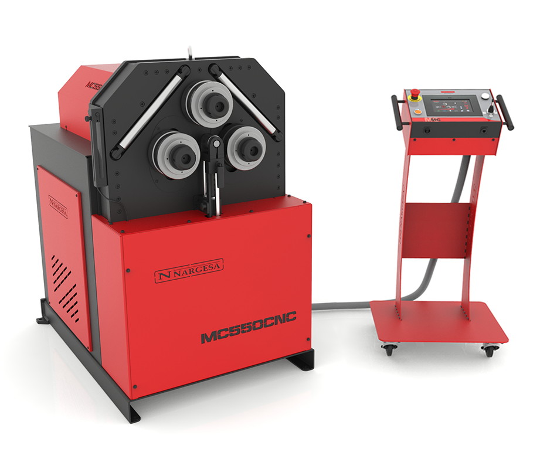

<!--
Projet Redmine : Tutoriels
Source : Question
ID source : 266
Section : Machines
Derniere modification : 2026-05-26 14:48:04
-->

# Cintreuse à galets - MC550CNC Nargesa

Cintreuse à galets - MC550CNC Nargesa

[Page produit](https://nargesa.com/fr/machines-industrielles/cintreuse-de-tubes-cnc-mc550cnc?_gl=1*1tepq6k*_up*MQ..*_ga*MjAxMDE0MjY0Ni4xNzc5Nzk2ODE4*_ga_ZBFLFG5XBP*czE3Nzk3OTY4MTckbzEkZzEkdDE3Nzk3OTY4MjYkajUxJGwwJGgwJGQ1MmF1NkxqNGNDNGYyaWVTbGNIQktfZVp3MUswS1o2b2FR)

[Manuel d'utilisation](https://agrilab.unilasalle.fr/projets/attachments/download/8104/manuel-dinstructions-mc550cnc_compressed.pdf)
# Cintreuse à galets CNC MC550CNC
## Description générale

La *MC550CNC* est une cintreuse à galets CNC à trois rouleaux, conçue pour le cintrage progressif de tubes et de profilés métalliques tels que l’acier, l’inox ou l’aluminium.

À l’AgriLab, cette machine est utilisée dans les contextes suivants :
* prototypage mécanique et structurel,
* fabrication de pièces unitaires ou de petites séries,
* projets pédagogiques avancés (FabAcademy, projets étudiants, R&D).

La MC550CNC permet un contrôle précis du rayon de courbure, une bonne répétabilité des formes et la programmation numérique de géométries complexes.
## Principe de fonctionnement

Le cintrage est réalisé par le passage du matériau entre trois galets motorisés disposés en configuration pyramidale.

* *Axe R* : galet supérieur assurant l’entraînement du matériau
* *Axes X et Y* : galets inférieurs commandés hydrauliquement, déterminant le rayon de cintrage

Le rayon obtenu dépend :
* de la position relative des axes X, Y et R,
* du diamètre des galets utilisés,
* du matériau et de son comportement en déformation plastique.

Le cintrage est progressif et s’effectue sans mandrin. Les petits rayons nécessitent plusieurs passes successives.
## Caractéristiques techniques principales
### Dimensions et masse
* Dimensions : 925 × 1190 × 1341 mm
* Masse : environ 840 kg
### Motorisation
* Moteur principal : 1,5 kW (2 CV)
* Vitesse de rotation des galets : 3 à 8 tr/min
* Diamètre des galets : 170 mm
* Diamètre des axes : 50 mm
### Alimentation électrique
* Tension : 220 V monophasé
* Fréquence : 50/60 Hz
* Intensité nominale : 7 A

Les variateurs de fréquence ne sont pas multitension. Toute modification de l’alimentation électrique nécessite une intervention technique qualifiée.
## Système hydraulique

Le système hydraulique commande exclusivement le positionnement des axes X et Y.

* Moteur hydraulique : 0,75 kW
* Débit de la pompe : 1,5 L/min
* Pression de service : 200 kg/cm² (20 MPa)
* Capacité du réservoir : environ 16 L
* Huile recommandée : huile hydraulique type HM68
## Interface de commande CNC
### Éléments de commande
* Écran tactile couleur
* Joystick quatre directions
* Bouton poussoir de déplacement avec maintien obligatoire
* Bouton d’arrêt d’urgence
* Voyants d’état machine
### Capteurs
* Encodeur mesurant la position et la vitesse de l’axe R
* Photocellule détectant le début du matériau pour l’exécution automatique des programmes

Ces capteurs sont indispensables au fonctionnement en mode automatique et à la répétabilité des cintrages.
## Modes de fonctionnement
### Mode manuel

Le mode manuel permet :
* le déplacement direct des axes X, Y et R,
* les essais matière,
* les réglages initiaux,
* la réalisation de barres d’essai.

Ce mode est recommandé pour l’apprentissage, le prototypage et les réglages avant production.
### Mode automatique (étape par étape)

Ce mode permet de créer des programmes séquentiels composés d’étapes successives.
Il est adapté aux géométries simples à intermédiaires et présente un intérêt pédagogique important.
### Mode programme numérique

Le mode programme numérique permet l’édition directe des positions d’axes sans usinage préalable.

Types de courbes possibles :
* courbure en deux étapes,
* courbure calandrée en plusieurs étapes,
* courbure interpolée avec déplacement simultané des axes X et R.

Ce mode est réservé aux utilisateurs expérimentés maîtrisant le comportement matière.
### Mode production

Le mode production permet l’exécution répétable de programmes finalisés.
Le maintien du bouton poussoir est obligatoire durant toute l’opération afin de garantir la sécurité de l’opérateur.
## Capacités de cintrage (indicatif)

| Type de profil | Capacité maximale |
| Tube rond acier | Ø 76 mm |
| Profilé carré | jusqu’à 80 × 80 × 6 mm |
| Profilé plat | selon galets installés |

Le rayon minimum dépend du matériau, du profil et des galets utilisés. Une barre d’essai est systématiquement recommandée.
## Sécurité
### Équipements de protection individuelle obligatoires
* Lunettes de protection
* Gants de manutention
* Chaussures de sécurité
### Risques identifiés
* Pincement entre les galets
* Entraînement incontrôlé de la pièce
* Projection de la pièce en sortie de cintrage
### Règles de sécurité essentielles
* Ne jamais placer les mains dans la zone de cintrage
* Toujours maintenir le bouton poussoir en mode production
* Ne jamais utiliser de galets non référencés ou non validés
* Toujours arrêter la machine avant toute intervention mécanique
## Maintenance

* Graissage régulier des parties mobiles selon les alertes CNC
* Contrôle des flexibles hydrauliques tous les six mois
* Vidange de l’huile hydraulique toutes les 2000 heures ou tous les cinq ans
## Bonnes pratiques à l’AgriLab

* Toujours réaliser une barre d’essai pour tout nouveau matériau ou section
* Documenter les paramètres utilisés dans le carnet de projet
* Ne jamais lancer une production sans validation par un FabManager
* Nettoyer et ranger la machine après utilisation
## Ressources

* Manuel constructeur MC550CNC
* Schémas électriques et hydrauliques
* Formations internes AgriLab
## Responsabilité

L’utilisation de la MC550CNC est réservée aux utilisateurs formés et autorisés.
En cas de doute sur un réglage, une procédure ou un comportement machine, l’utilisation doit être interrompue et un FabManager contacté.
