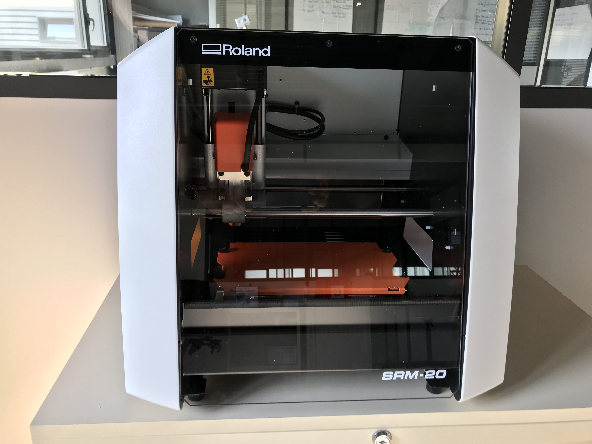
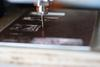
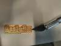
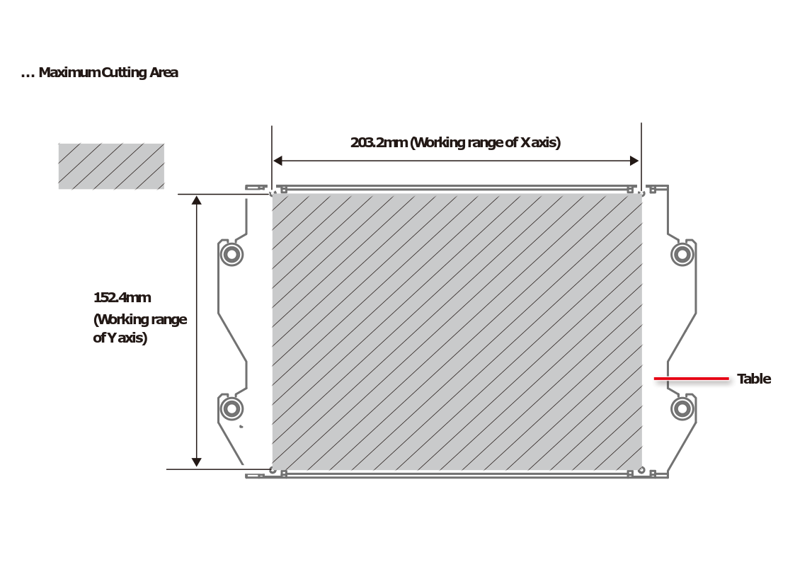
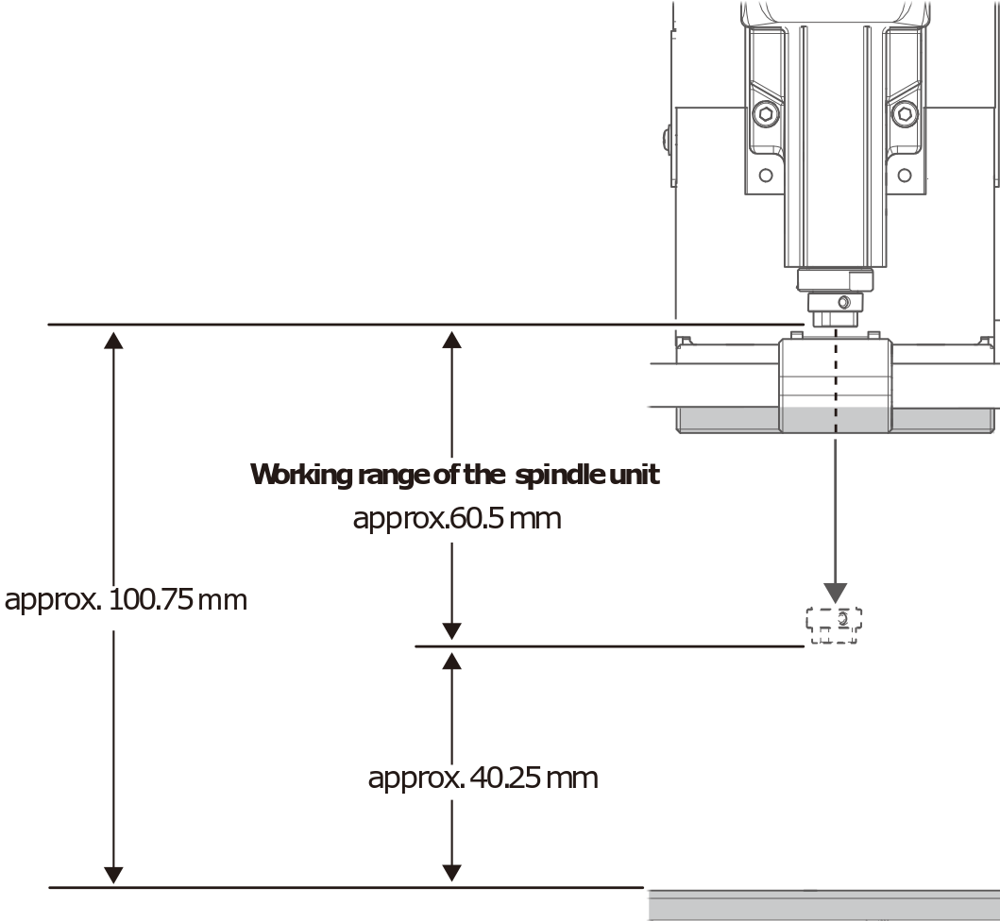

<!--
Projet Redmine : Tutoriels
Source : Question
ID source : 44
Section : Machines
Derniere modification : 2019-09-16 14:11:44
-->

# CNC Roland SRM 20 - électronique

Fraiseuse dédiée au fraisage de plaques de cuivres pour la réalisation de circuits électroniques PCB.

  

lien http://startup.rolanddg.com/monoFab/SRM-20/Toppage/SRM-20_Win_Env_EN.html

manuel en anglais : http://support.rolanddga.com/docs/documents/departments/technical%20services/manuals%20and%20guides/srm-20_use_en.pdf
## Dimensions usinables

## plaques de cuivres

* Carte cuivre nue, Double face, 150 x 100 x 1.6mm, 35μm, FR4, reférence RS : 890-3601 ; référence constructeur :  AE10 , specification : https://docs-emea.rs-online.com/webdocs/1461/0900766b81461864.pdf
* Carte cuivre nue, Simple face, 150 x 100 x 1.6mm, 35μm, FR4,reférence RS : 890-3607 ; référence constructeur :  AD10 , specification : https://docs-emea.rs-online.com/webdocs/1461/0900766b81461863.pdf
## Fraises

Informations uniquement disponibles sur place
## Martyr

position :
x 10,75
y 0
Z -46,40

martyr : -0,10mm

dimension du martyr
largeur 184,75
longueur 152,40
