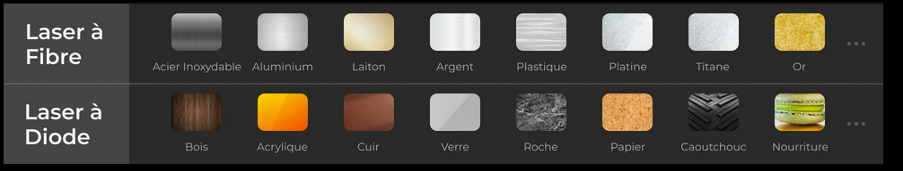
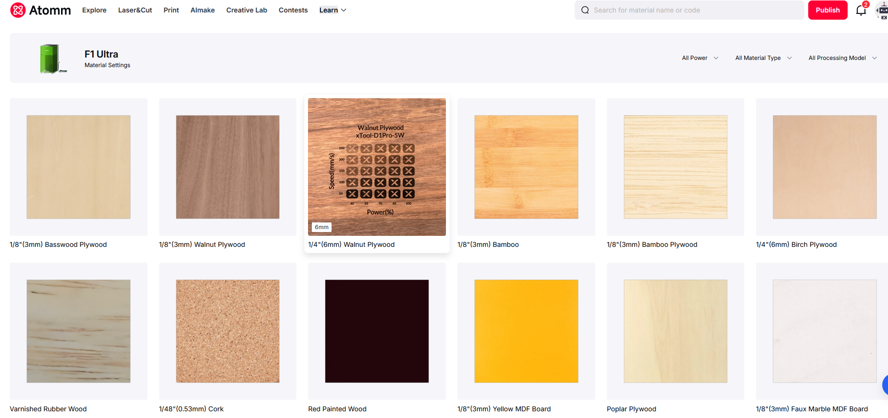
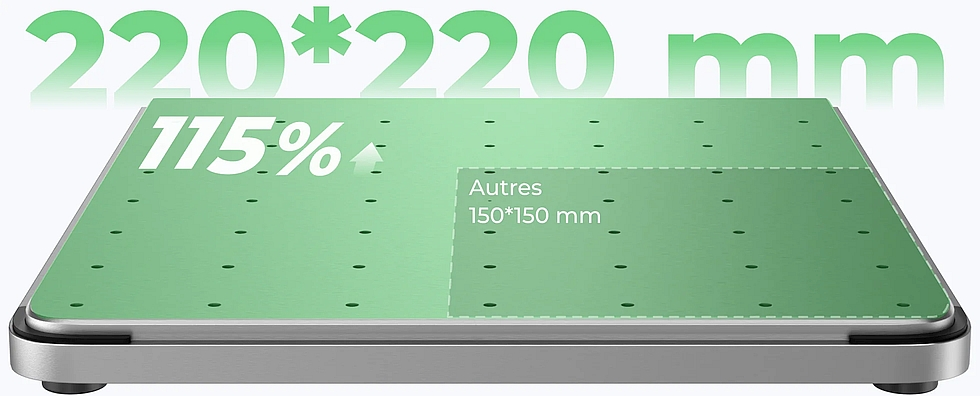

<!--
Projet Redmine : Tutoriels
Source : Question
ID source : 252
Section : Machines
Derniere modification : 2026-09-04 15:15:32
-->

# Découpe Laser - xTool F1

Wiki, rédaction en cours

https://fr.xtool.com/products/xtool-f1-ultra-graveur-laser-double-fibre-et-diode-20w

Laser double technologie de 20W Fibre & 20W Diode
Cette double technologie permet d'élargir le choix des matériaux compatibles par rapport à une découpeuse laser à tube CO2

### Découpe de métal fin:

Le laser à fibre de 20 W du F1 Ultra permet de découper avec précision des feuilles de laiton jusqu'à 0,4 mm, des feuilles d'acier inoxydable jusqu'à 0,3 mm et des feuilles d'aluminium jusqu'à 0,2 mm.
### Découpe de bois et acrylique:

Le laser à diode de 20 W intégré au F1 Ultra est suffisamment puissant pour découper du bois jusqu'à 15 mm d'épaisseur et de l'acrylique jusqu'à 12 mm.

Sous certaines conditions des effets de couleurs peuvent être obtenus en gravant du métal.
### Matériaux et réglages

Le constructeur partage des informations sur les réglages de puissances, *à toujours adapter à votre matériau* : https://www.atomm.com/easyset/collection/GS002?t=laser&n=F1+Ultra

### Dimensions du plateau:

Maximum 220*220mm (sous conditions) et 150*150mm

### Sécurité:

Les matériaux dégageant des fumées toxiques sont strictement interdits.
La formation à cet équipement est obligatoire, les règles de sécurité, manière de réagir en cas de départ de feu, fumée anormale sont a connaître à tout moment. L'équipe d'AgriLab doit être immédiatement alertée en cas de doutes.

*Il est strictement de faire fonctionner le laser en mode découpe ou gravure avec le capot de la machine ouvert et de désactiver les sécurités.*
La découpeuse laser est en classe 1 quand le capot est fermé empêchant toute exposition directes et réflexions.
Certains matériaux peuvent être interdits à la découpe par le responsable.

La machine est en classe laser 1 si les conditions sont respectées et ne nécessite donc pas de mesures supplémentaires, c'est le seul fonctionnement autorisé. *L'utilisation en classe 4 est interdite* par les personnes non formées et non habilitée, les personnes autorisées travaillent uniquement sous conditions particulières détaillées par le Responsable Sécurité Laser/LSO.
## Logiciel dédié

xTool studio : https://fr.xtool.com/pages/logiciel
## Crédit et remerciements

Grâce au programme _1% for the Makers_ de xTool , AgriLab UniLaSalle a reçu un équipement en don, https://www.xtool.com/

Nous remercions xTool pour ce don généreux 
