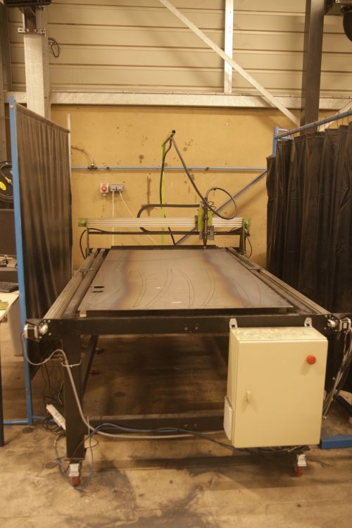
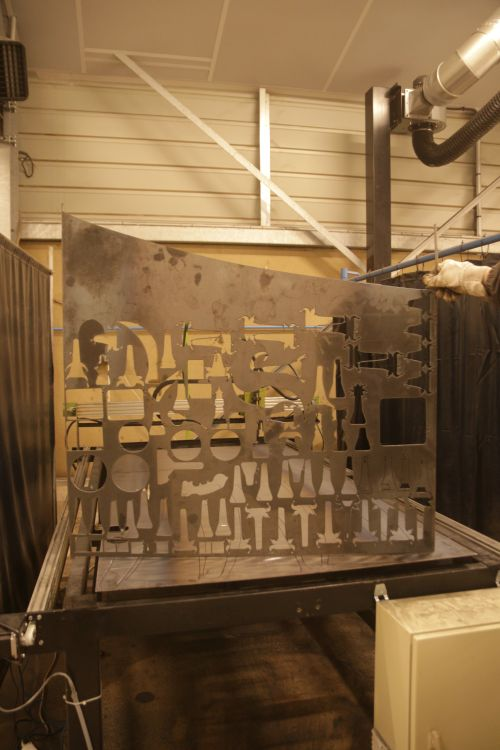
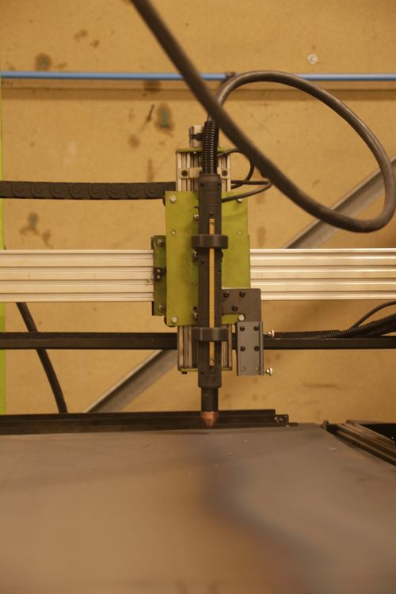
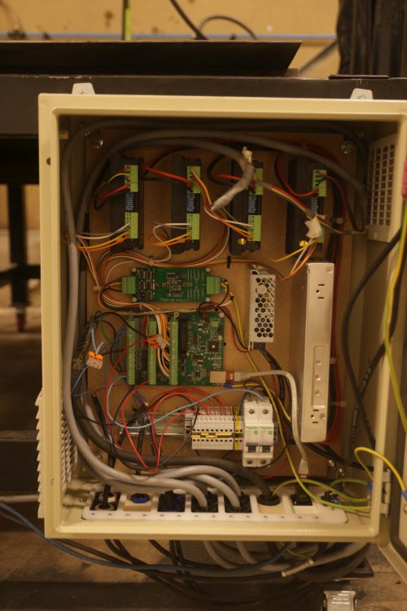
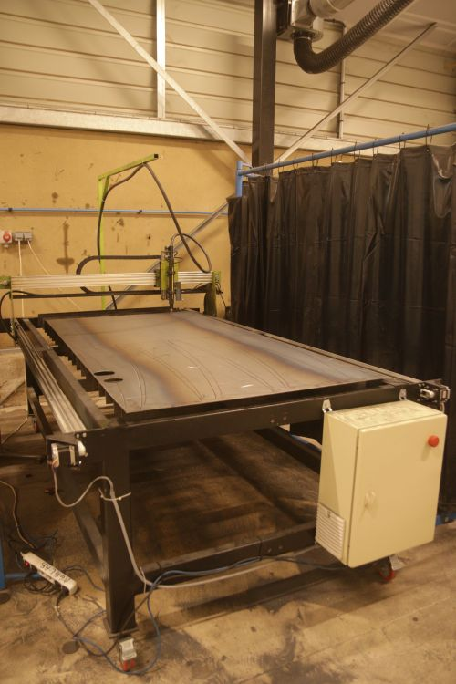

<!--
Projet Redmine : Tutoriels
Source : Question
ID source : 221
Section : Machines
Derniere modification : 2024-04-03 11:09:00
-->

## Découpeuse plasma CNC -LinuxCNC - QTPlasmaC - Mesa 7i96s

[Poste de découpe plasma Hypertherm Powermax 45XP](https://agrilab.unilasalle.fr/projets/projects/tutoriels/questions/38-decoupeuse-plasma-hypertherm-powermax-45-xp)
Dimensions usinables : 2200mm * 1200 mm
Intensité max : 45A
THC (Torch Height Control) avec carte [Mesa THCAD 5](http://www.mesanet.com/pdf/analog/thcadman.pdf) : contrôle de la hauteur de coupe en fonction de la tension d'arc, permet de compenser les déformation de la matière.
Logiciel de contrôle : [LinuxCNC](http://linuxcnc.org/) - [QTPlasmaC](https://linuxcnc.org/docs/devel/html/plasma/qtplasmac.html)
Carte de contrôle : [Mesa 7i96s](http://www.mesanet.com/pdf/parallel/7i96sman.pdf)
[Atelier Découpe plasma](https://agrilab.unilasalle.fr/projets/projects/tutoriels/questions/209-atelier-decoupe-plasma)
[Abaque Hypertherm Powermax 45XP](https://agrilab.unilasalle.fr/projets/attachments/download/3980/PowerMax45XP%20-%20Cutting%20and%20Marking%20chart.pdf)

[Atelier Découpe plasma](https://agrilab.unilasalle.fr/projets/projects/tutoriels/questions/209-atelier-decoupe-plasma)
