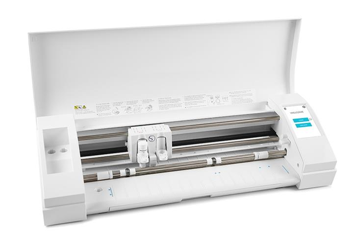

<!--
Projet Redmine : Tutoriels
Source : Question
ID source : 22
Section : Machines
Derniere modification : 2021-02-17 14:55:20
-->

# Découpeuse vinyle Silhouette CAMEO 3

Découpeuse vinyle, découpe avec une lame.

largeur de travail 305mm - longeur limitée à 3m
Option ploteur et autres
réglages de hauteur de lame automatique jusqu'à 1mm, sinon lame fixe à 2mm
logiciel en ligne : http://silhouettefr.fr/silhouette_logiciel.html

à tester, plugin inkscape : https://github.com/fablabnbg/inkscape-silhouette
