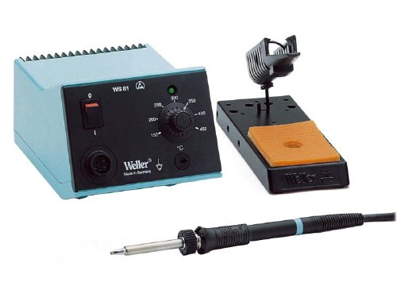
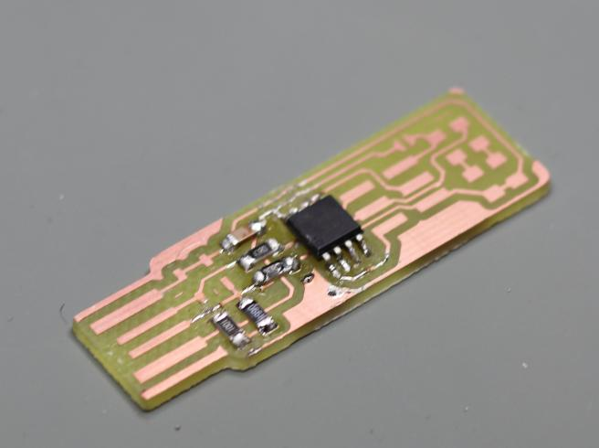

<!--
Projet Redmine : Tutoriels
Source : Question
ID source : 55
Categorie export : machines
Section Redmine : Machines
Derniere modification : 2019-09-16 15:06:32
-->

# Fer à souder Weller WS81

Fer à souder à étain pour composants électroniques. Traitement ESD.

 

*Attention à bien nettoyer la panne après chaque utilisation.*
