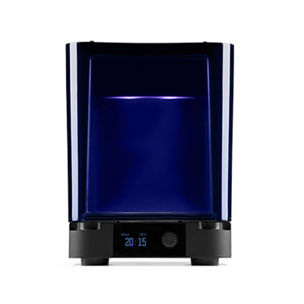
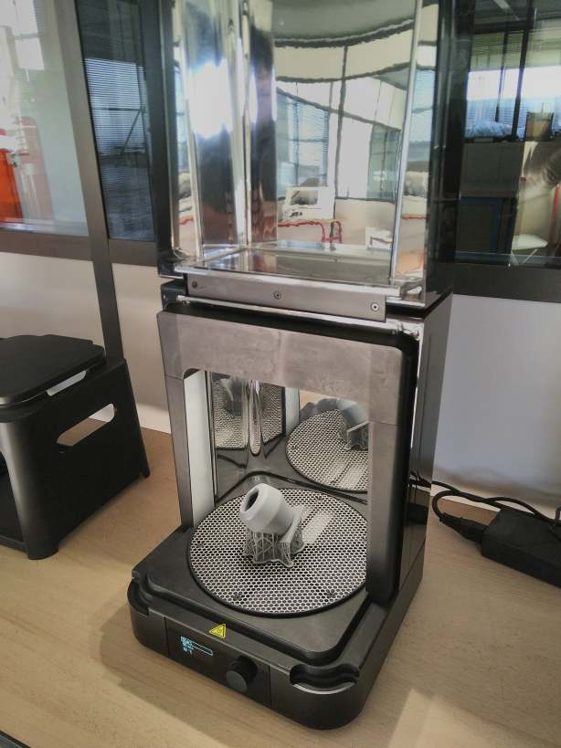

<!--
Projet Redmine : Tutoriels
Source : Question
ID source : 31
Section : Machines
Derniere modification : 2020-06-22 09:24:36
-->

# Formlabs Cure

Post-traitement nécessaire pour les impressions en résine (suite du post-traitemenent de la la "Formlabs Wash":/projets/questions/30-formlabs-wash)

Unité d'insolation et de chauffage pour le post-traitement des impressions réalisées par la From2.
Pour une solidification complète de la résine, elle est insolée aux UV pendant une certaine durée à une certaine température.

|||

Temps d'insolation recommandés par types de résine : https://support.formlabs.com/s/article/Form-Cure-Time-and-Temperature-Settings?language=fr

|_.Material|_.Temperature|_.Time recommended|_.Time for full cure|
|Black V4 (FlGPBK04)|60 °C|30 min|60 min|
|Clear V4 (FLGPCL04)|60 °C|15 min|30 min|
|Grey V4 (FLGPGR04)|60 °C|30 min|60 min|
|White V4 (FLGPWH04)|60 °C|30 min|60 min|

!2019-02-26%2011_38_23-Form%20Cure%20Time%20and%20Temperature%20Settings.png!

|Diamètre de la plaque tournante|19.3 cm|
|Hauteur de pièce max.|18.5 cm|
|Conditions environnementales optimales|18 - 28 °C|
|Temperature max. de la chambre|80°C|
|Source de lumière| 13 LED multi-directionnelles|
|Puissance LED|39 W|
|Rayon LED|9.1 W|
|Longueur d'ondes LED|405 nm|

Page du fabricant https://formlabs.com/fr/wash-cure/
