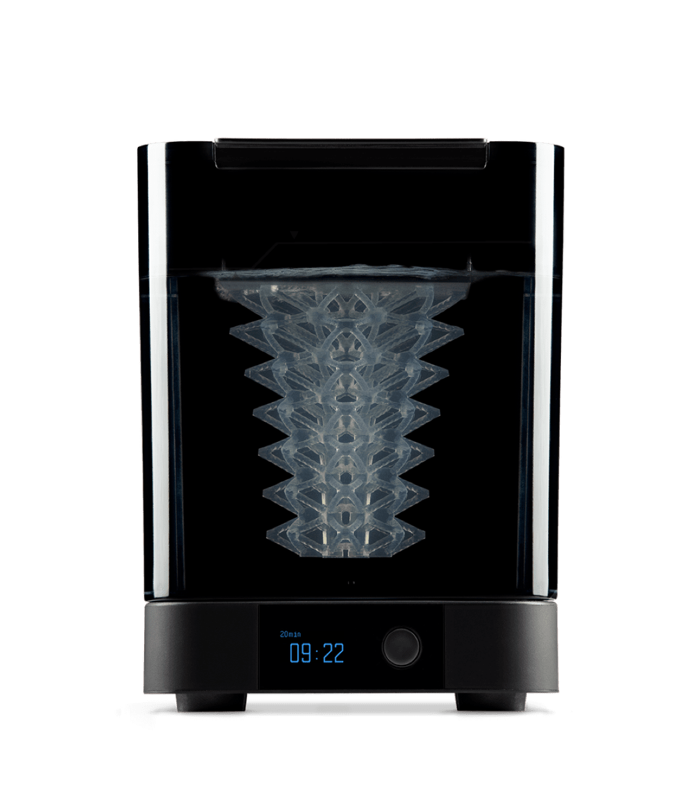
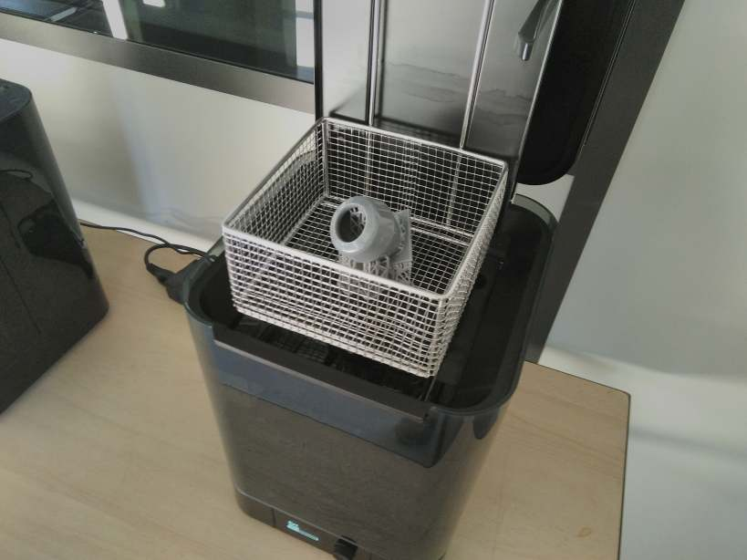

<!--
Projet Redmine : Tutoriels
Source : Question
ID source : 30
Section : Machines
Derniere modification : 2020-06-22 09:23:23
-->

# Formlabs Wash

Post-traitement pour les impressions en résine (issues de la "Formlabs Form 2":/projets/projects/tutoriels/questions/29-imprimante-3d-form2-formlabs-2)

La résine doit être traitée avec de l'alcool isopropylique pour enlever les dépôts de résine non solidifiée.
La Formlabs Wash agite le liquide pour qu'il accède bien à toute les parties de la pièce.
Avec ce traitement, l'aspect poisseux disparait.
Il faut ensuite mettre l'impression dans la Formlabs Cure.

|||

Durée de lavavage pour les résines classsiques (black, clear, grey, white, color) : *10 min*

Durée résines techniques https://support.formlabs.com/s/article/Form-Wash-Time-Settings?language=fr

Il a été observé que la surface des pièces reste collante lorsqu'elles sont lavées avec de l'alcool isopropylique dont la concentration en résine est supérieure à 10 % (résines classiques).

Guide utilisateur en français: https://support.formlabs.com/s/article/Using-Form-Wash?language=fr
Page du fabricant: https://formlabs.com/fr/wash-cure/

|Volume de la cuve (IPA) |8.6 L d’isopropanol (IPA) pour remplir le bac|
|Taille maximale de la pièce |14.5 × 14.5 × 17.5 cm|
|Conditions environnementales optimales |18 - 28 °C|
|Méthode d’agitation |Turbine d’entrainement magnétique|
