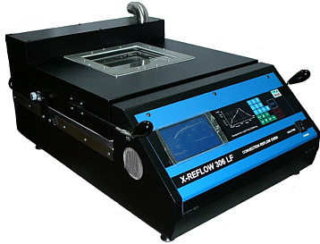

<!--
Projet Redmine : Tutoriels
Source : Question
ID source : 59
Section : Machines
Derniere modification : 2019-09-16 15:16:05
-->

# Four reflow pour carte électronique - Bokar X-Reflow306 LF-AC

Four dédié à la cuisson de carte électronique avec élévation très rapide et contrôlée de la température et refroidissement. Traitement ESD.

Manuel d'utilisation en anglais : attachment:"X-Reflow306LF-AC Man171A-Rev J -I-2018.pdf"

Lien du constructeur : http://www.bokar.com/x-reflow306lf-ac.html
