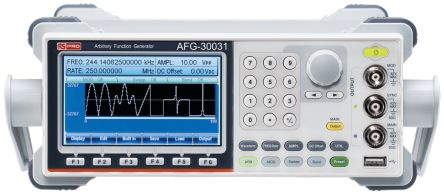

<!--
Projet Redmine : Tutoriels
Source : Question
ID source : 58
Section : Machines
Derniere modification : 2019-09-16 15:12:51
-->

# Générateur de fonctions arbitraires RS Pro, 50MHz, AFG-31051

Générateur de fonctions arbitraires RS Pro, 50MHz, AFG-31051

Spécifications : attachment:generateur50MHz-spec.pdf
Manuel de démarrage rapide : attachment:AFG-31051_QSG(FR)_RS%20PRO.pdf
Manuel : attachment:AFG-31051_User%20Manual(EN).pdf
