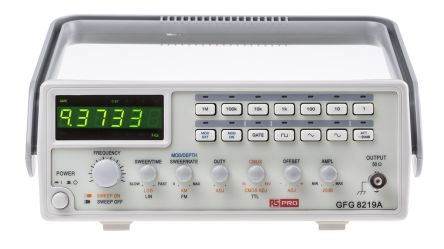

<!--
Projet Redmine : Tutoriels
Source : Question
ID source : 54
Section : Machines
Derniere modification : 2019-09-16 14:56:16
-->

# Générateur de fonctions, RS Pro, 3MHz

Générateur de fonctions, RS Pro, 3MHz

Spécifications : assets/files/generateur3mhz-spec.pdf
