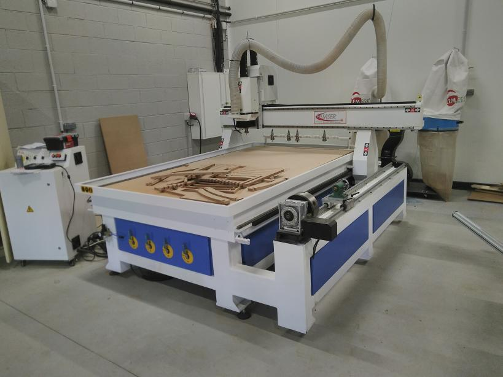
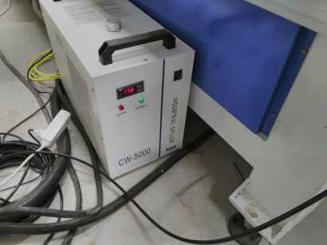
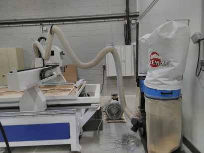
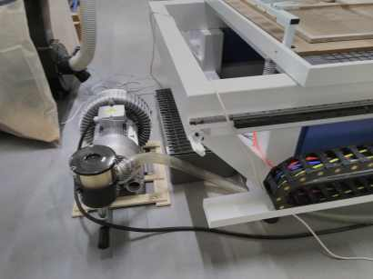
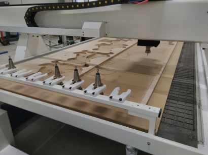
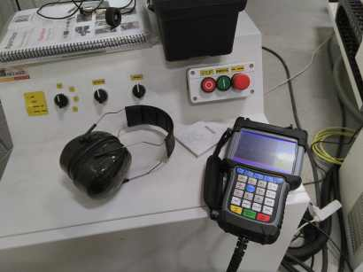
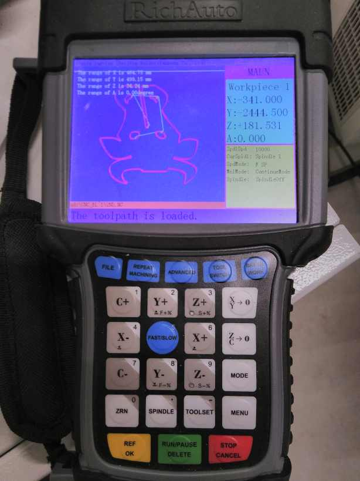
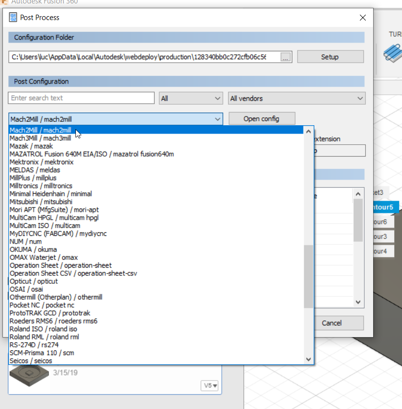

<!--
Projet Redmine : Tutoriels
Source : Question
ID source : 34
Section : Machines
Derniere modification : 2023-11-08 10:09:37
-->

# Grand Routeur CNC 3 axes

Grand Routeur CNC 3 axes avec tourne cylindre, changeur d'outils et table à dépression.

Dimensions usinables : 1500mm * 2400 mm * épaisseur en fonction d'autres paramètres (martyre, longueur de la fraise,...)
Vitesse de rotation de la broche max : 24000 tour/min

Changeur d'outils : 8 outils
Aspiration à copeaux de bois, circuit de bain d'huile pour la découpe de métal.
## Composed of several units :

A cooler for the spindle motor.

A dust collecting system .

A vacuum table .

A tool changer .

The control unit and the remote control .

## Remote control

To control the position you click the X,Y or Z arrow the + or - invert the direction of the motion. The fast/slow key change the motion key when you continuously press the motion key and when you make a short click it modify the precision of the displacement.

The XY->0 fixed the G54 home in X and Y The ZC->0 fixed the G54 home in Z

The C letter is a wrong labelling it should be B for the rotation along the Y axis.

The Toolset is an automatic Z , you have to use an electric sensor that measure the contact between the spindle and the sensor. It’s a precise way to determine the Z.

The Toolswitch allow you to change of tool. The tool changer has 8 position.

The File allow you to select your file on the usb key. You confirm with the yellow OK key. And you start the job by clicking the green run/pause key
## Post-processeur Fusion

sélectionner le post-processeur @mach2MILL@ dans la liste

NON FONCTIONNEL : Installer et sélectionner le post processeur suivant : attachment:mllaser agrilab.cps

Quelques tutoriels pour en apprendre plus:

https://www.instructables.com/classes/tagged/cnc/

https://academy.titansofcnc.com/

Informations technique et formules pour référence

https://www.sandvik.coromant.com/fr-fr/knowledge/milling/pages/default.aspx (guide en français)

http://www.mmus-carbide.com/technical_information

http://www.mmus-carbide.com/technical_information#section-2 (formules)

https://wiki.harvard.edu/confluence/display/fabricationlab/Choosing+Toolpaths (stratégie de coupe)

https://wiki.harvard.edu/confluence/display/fabricationlab/Choosing+Tools (type de fraise)

https://wiki.harvard.edu/confluence/display/fabricationlab/Selecting+a+Stepover (pas de recouvrement)
