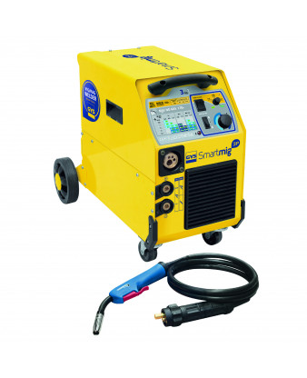

<!--
Projet Redmine : Tutoriels
Source : Question
ID source : 37
Categorie export : machines
Section Redmine : Machines
Derniere modification : 2019-09-11 16:42:48
-->

# GYS Smartmig 3p Poste à souder Mig Mag / électrode

Soude l’acier, l’inox, l’aluminium et la fonte.

170A
Soude l’acier, l’inox, l’aluminium et la fonte.
3 procédés :
- Soudage MIG/MAG (avec gaz), fil plein 0,6 /0,8 /1,0 mm
- Soudage No Gaz (sans gaz),fil fourré 0,9 /1,2 mm
- Soudage à l’électrode (MMA) 2,0 /2,5 /3,2 mm

Fils disponnibles : bobine fil fouré 0.9mm et fil acier 0.8mm

Fiche technique : http://www.gys.fr/pdf/datasheet/fr/033177.pdf
Mode d'emplois : http://www.gys.fr/pdf/manual/fr/033177.pdf
