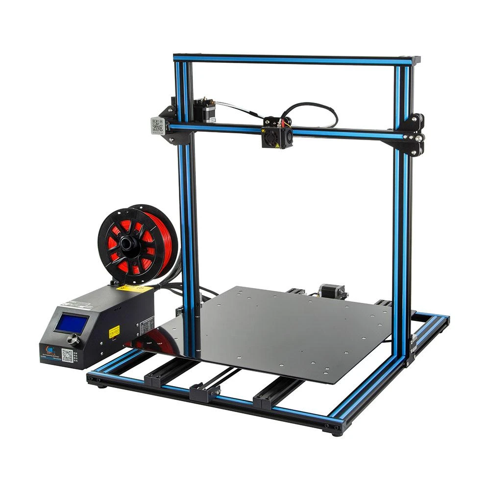
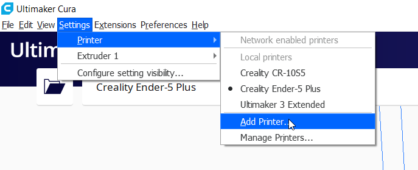
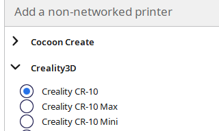

<!--
Projet Redmine : Tutoriels
Source : Question
ID source : 180
Section : Machines
Derniere modification : 2021-01-07 15:36:06
-->

# Imprimante 3D - Creality CR-10 S5

Imprimante 3D à filament de type FDM (Fused Deposition Modeling ou dépot de filament fondu) grand format.

Page fabriquant https://www.creality.com/goods-detail/creality-cr-10-s5-3d-printer

Utiliser le logiciel Cura (ou autre slicer) pour générer un fichier .g-code permettant de décrire les déplacements et instructions envoyer à l'imprimante via une carte microSD.

Page de téléchargement de Cura https://ultimaker.com/fr/software/ultimaker-cura

|Volume de construction|*500x500x500 mm*|
|Résolution des couches|40 micron (0,04 mm)|
|Diamètre du filament|1,75 mm|
|Diamètre de la buse|0,4 mm|
|Vitesse d'impression|normal 60 mm/s maximum 100 mm/s|
|Température maximum de la buse|260°C|
|Température maximum du plateau|60°C|
|Système d'extrusion|bowden (déporter)|
|Système de coordonnées|cartésien|
## Ajouter l'imprimante dans Cura

Dans Cura , sélectionner settings , printer , add printer

Choisir add a non-networked printer

Sélectionner la marque ensuite le modèle exact dans la liste proposée

