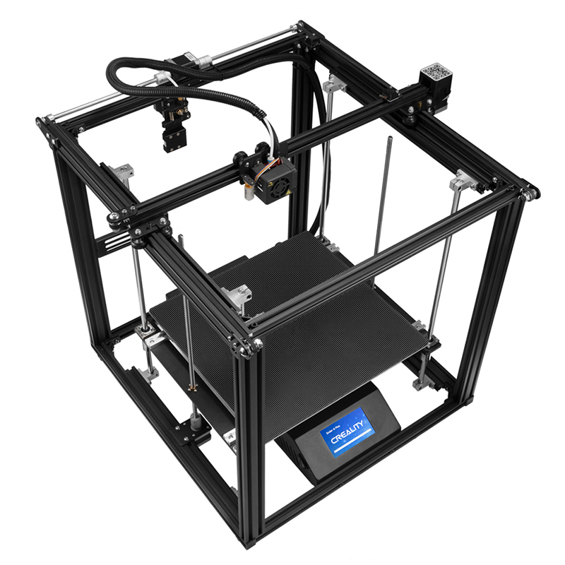

<!--
Projet Redmine : Tutoriels
Source : Question
ID source : 181
Section : Machines
Derniere modification : 2021-01-07 15:32:04
-->

# Imprimante 3D - Creality Ender 5 Plus

Imprimante 3D à filament de type FDM (Fused Deposition Modeling ou dépot de filament fondu) très stable et donc rapide.
Elle est équipé d'une calibration automatique du plateau ainsi qu'un plateau chauffant.

Page fabriquant https://www.creality.com/goods-detail/ender-5-plus-3d-printer

Utiliser le logiciel Cura (ou autre slicer) pour générer un fichier .g-code permettant de décrire les déplacements et instructions envoyer à l'imprimante via une carte microSD.

Page de téléchargement de Cura https://ultimaker.com/fr/software/ultimaker-cura

|Volume de construction|*350x350x400 mm*|
|Résolution des couches|40 micron (0,04 mm)|
|Diamètre du filament|1,75 mm|
|Diamètre de la buse|0,4 mm|
|Vitesse d'impression|normal 80 mm/s|
|Température maximum de la buse|260°C|
|Température maximum du plateau|110°C|
|Système d'extrusion|bowden (déporter)|
|Système de coordonnées|cartésien|
## Ajouter l'imprimante dans Cura

Dans Cura , sélectionner settings , printer , add printer

Choisir add a non-networked printer

Sélectionner la marque ensuite le modèle exact dans la liste proposée

