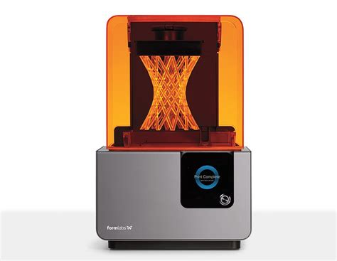
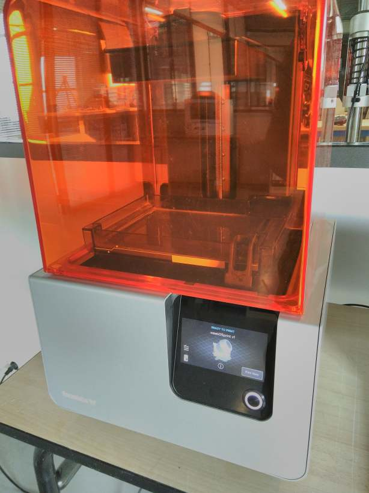
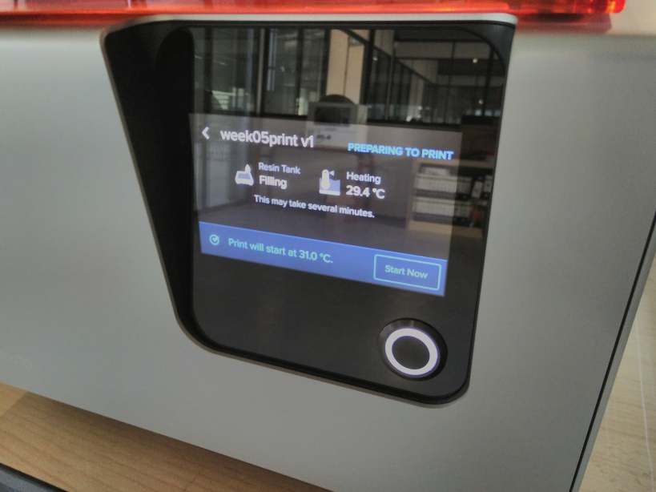
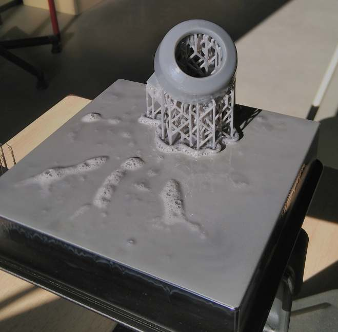

<!--
Projet Redmine : Tutoriels
Source : Question
ID source : 29
Section : Machines
Derniere modification : 2019-09-18 10:28:38
-->

# Imprimante 3D - Form2 - Formlabs 2

Imprimante 3D en stéréolithographie SLA. 
Matériaux : différent types de résines ayant des propriétés particulières

Taille du faisceau laser : 140µ
Volume d'impression : 14,5 × 14,5 × 17,5 cm
Épaisseur de couches : 25 - 300 microns
Longueur d'onde : 405 nm

Logiciel à utiliser "Preform":/projets/questions/69-preform
## Manipulation pour imprimer

La préparation du fichier est détaillée dans le Tutoriel d'AgriLab sur l'utilisation de "Preform":/projets/questions/69-preform

En connectant l'ordinateur à l'imprimante, cliquer sur le bouton imprimer. Il y a plusieurs messages de confirmation sur l'écran tactile de l'imprimante.

La résine est préchauffée à 31°C avant le démarrage. Une fois la température atteinte, appuyer sur *Start* .

Pendant l'impression, l'imprimante effectue une série d'opération pour chaque couches. La résine est agitée par le déplacement d'un slideur qui plonge dans le bac. Le laser positionné sous le bac fait un passage sur la géométrie de la couche et solidifie la résine. Ensuite une autre couche est traitée, le plateau remonte, la résine est agitée par le slideur et ainsi de suite pour toutes les couches.

à la fin de l'impression le plateau reste en haut et l’imprimante se met en veille.

Retirer délicatement le plateau en protégeant vos main avec des gants. Faites attention à ne pas contaminer la résine restante dans le bac et le reste de la machine.

*Il est nécessaire de refermé +immédiatement+ la machine* pour éviter toute contamination par de la poussière ou par la lumière qui va solidifier la résine inutilisée dans la machine.

Il faut ensuite décoller l'objet imprimé et effectuer le post-processing.

*La résine contaminée ou les excès de résines sur l'impression doivent être +jetée selon un protocole précis+ à TOUJOURS respecter.*
## Post-processing

Le post-processing est simplifié par l'utilisation de deux machines à utiliser dans l'ordre suivant :
# FormLabs Wash - qui va retirer les petit excès de résines et plonge la résine dans de l'Alcool isopropylique
# FormLabs Cure - qui va chauffer et insoler l'impression au UV pour solidifier complètement la résine
