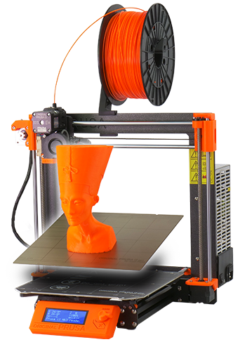

<!--
Projet Redmine : Tutoriels
Source : Question
ID source : 28
Section : Machines
Derniere modification : 2020-03-26 10:01:34
-->

# Imprimante 3D - Prusa i3 mk3

Imprimante 3D à filament de type FDM , modèle Open-Source à construire en kit.

Volume d'impression : 25 x 21 x 21 cm 
Buse d'impression : 0,4mm
Hauteur de couche en Z : 0,05 mm

info : https://www.prusa3d.com/original-prusa-i3-mk3/
## video timelapse de la construction de l'imprimante

<iframe width="967" height="544" src="https://www.youtube.com/embed/nvZIOwL7Dyo" frameborder="0" allow="accelerometer; autoplay; encrypted-media; gyroscope; picture-in-picture" allowfullscreen></iframe>
## Installation des profils pour utilisation dans Cura

!https://d17kynu4zpq5hy.cloudfront.net/igi/prusa3d/rt6gL1wKRDxZUEXq.medium!

https://manual.prusa3d.com/Guide/How+to+import+profiles+to+Cura+3.6+(Windows+&+macOS)/703

Bien suivre les instructions; il y a plusieurs fichiers à installer à différents endroits.
