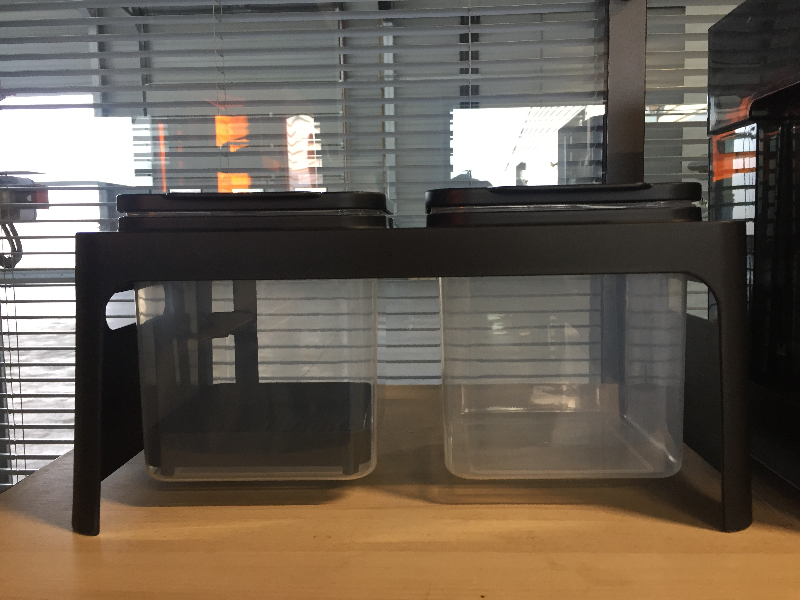
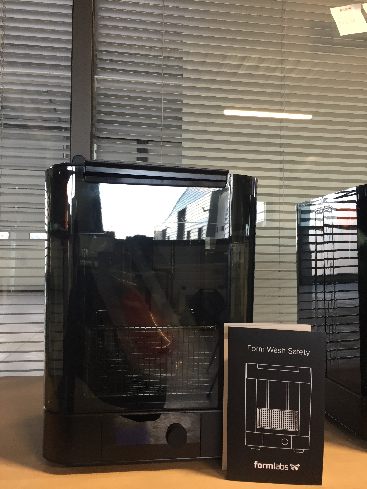
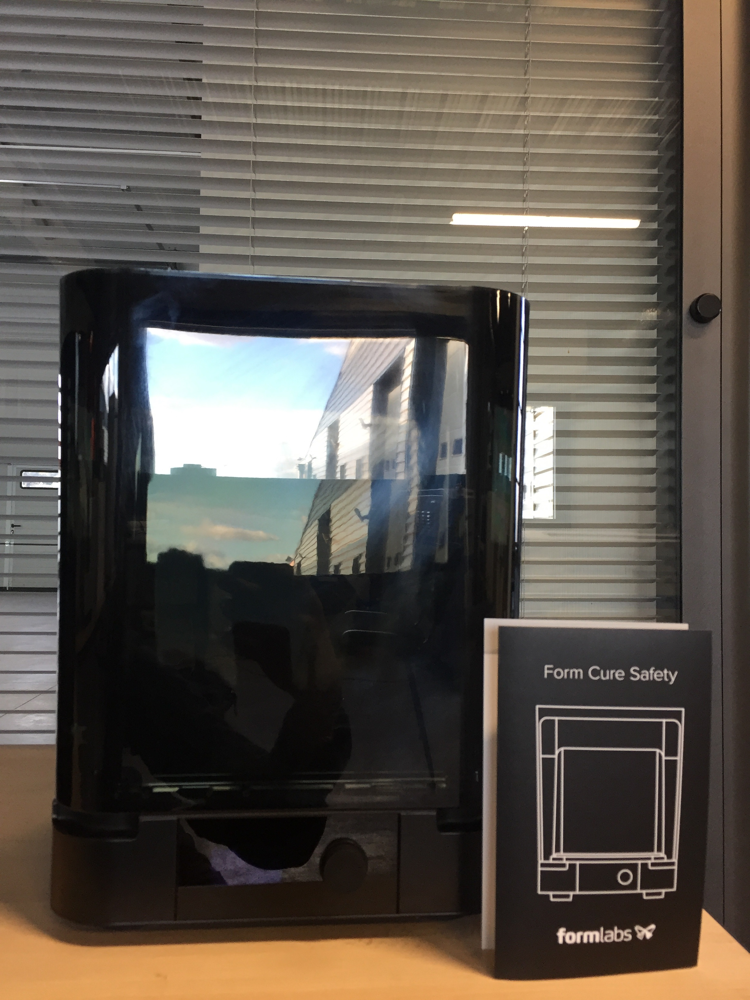

<!--
Projet Redmine : Projet FabLab 
Source : WikiPage
ID source : 123
Categorie export : machines
Derniere modification : 2018-09-25 14:08:33
-->

# Imprimante 3D - FormLabs Form 2
## Fiche Technique      

Imprimante 3D par Photopolymérisation Laser
Qualité : épaisseur de couche 25 à 100 microns (0,025mm à 0,1mm)
Volume d'impression : 145 x 145 x 175 mm
Impression 16 résines utlisables sous forme de cartouches changeable
Impression précise et rapide
Diamètre du faisceau laser : 140 microns
Logiciel : PreForm
Connexion : Wifi
Poids : 13 kg
## Accessoires

 
## Mode d'Emploi

Etape 1 : Conception 
Etape 2 : Impression
Etape 3 : Rinçage dans de l’alcool isopropylique (IPA) 
Etape 4 : Cuisson UV

Choix des résines : https://formlabs.com/fr/materiels/
Conseil d'utilisation : https://formlabs.com/fr/3d-printers/form-2/design-specs/
Logiciel Preform : https://formlabs.com/fr/tools/preform/
